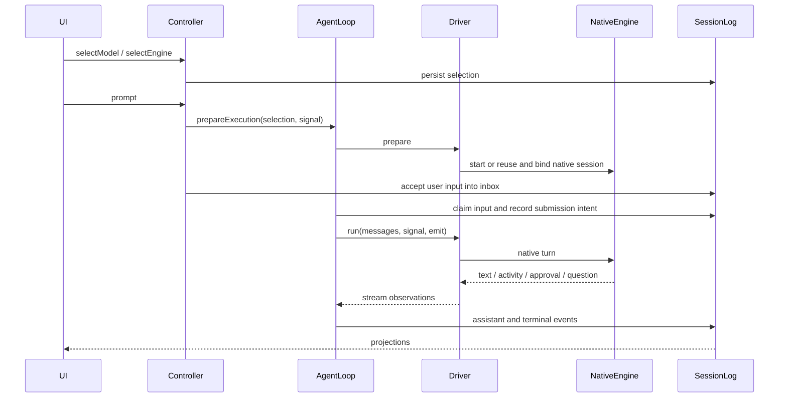

# Main conversation engines: implementation and migration reference

English | [中文](main-agent-engines.zh.md)

## Summary

The local [feature migration and iteration checklist](../worktree-feature-list.md) records the usable version tag, six optional plugins, installation and verification status, external launch configuration, and regression checks. It distinguishes current implementation from historical plans so a subsequent tool can identify remaining work without treating old design tasks as missing features.

Use this reference to locate the implementation of native, Claude Code, and Codex main conversations before extending or migrating them. It maps features to source files and symbols, separates engine plugins from shared runtime changes, and identifies the files and persisted data that must move together. Package READMEs remain authoritative for complete configuration schemas.

## Contents

- [Ownership and entry points](#ownership-and-entry-points)

- [Feature lookup](#feature-lookup)

- [End-to-end flow](#end-to-end-flow)

- [Claude execution](#claude-execution)

- [Codex execution](#codex-execution)

- [Persistence and recovery](#persistence-and-recovery)

- [File inventory](#file-inventory)

- [Migration procedure](#migration-procedure)

- [Verification and diagnosis](#verification-and-diagnosis)

- [Native child status implementation](#native-child-status-implementation)

- [Child observation and continuation lookup](#child-observation-and-continuation-lookup)

- [Failure handling and migration dependencies](#failure-handling-and-migration-dependencies)

- [Acceptance scope for child and recovery paths](#acceptance-scope-for-child-and-recovery-paths)

<a id="ownership-and-entry-points"></a>

## Ownership and entry points

The production integration uses `ReactLoopAgent` with an `EngineTurnDriver`. Harness owns input admission, cancellation, lifecycle, session events, and client projections; the external engine owns its native model/tool loop. Native tool observations are displayed and recorded, never executed a second time as Harness tools.

The engine packages live under `packages/subagent/`, but their `./startup` exports register main engines. Their existing `src/index.ts` delegation APIs and compatibility `ClaudeMainAgent` / `CodexMainAgent` classes are distinct entry points; extending those wrappers alone does not change the production main conversation.

| Layer | Files / owner | Responsibility |
|---|---|---|
| Shared kernel | [agent](../packages/core/agent/src/engines.ts), [agent-loop](../packages/core/agent-loop/src/agent.ts), [session](../packages/core/session/src/types.ts) | Engine registry, turn driver, external-turn lifecycle, durable events. |
| Engine plugins | [Claude startup](../packages/subagent/subagent-claude-code/src/startup.ts), [Codex startup](../packages/subagent/subagent-codex/src/startup.ts) | Process ownership, SDK / RPC translation, native storage, route-specific configuration. |
| Host service plugins | [session-controller](../packages/api/session-controller/README.md), [permission-presets](../packages/interaction/permission-presets/README.md), [user-approval](../packages/interaction/user-approval/README.md) | Serialized selection and prompt commands, policy resolution, human decisions. |
| Provider / UI plugins | LLM provider adapters, model settings, model selection, chat activity | Endpoint discovery, credentials references, selection controls, native activity presentation. |
| Deployment plumbing | [web-app bundle](../packages/bundle/web-app/README.md), [app-boot](../packages/boot/app-boot/README.md), [config-editor](../packages/boot/config-editor/README.md) | Activate plugins and choose profile/shared configuration ownership. |

<a id="feature-lookup"></a>

## Feature lookup

Paths below are repository-relative. Symbols name edit entry points rather than fixed line numbers; inspect their callers when changing a public API.

| Feature | File and symbols | Coupled consumers |
|---|---|---|
| Register a main engine | [packages/core/agent/src/engines.ts](../packages/core/agent/src/engines.ts) — `AgentEngineDefinition`, `EngineTurnDriver` | Engine `startup.ts` → `registerClaudeEngine` / `registerCodexEngine`; `ReactLoopAgent`. |
| Prepare / execute / close | [packages/core/agent-loop/src/agent.ts](../packages/core/agent-loop/src/agent.ts) — `prepareExecution`, `externalTurn`, `closeExecution` | Driver `prepare`, `run`, `close`; shared inbox and assistant stream. |
| Engine lock and historical default | [packages/api/session-controller/src/agent.ts](../packages/api/session-controller/src/agent.ts) — `engineFromEvents`, `engineForSession`, `createOrAdopt` | `commands.ts` → `selectEngine`; selection projection and client directory. |
| Model/vendor selection and prompt admission | [packages/api/session-controller/src/commands.ts](../packages/api/session-controller/src/commands.ts) — `selectModel`, `selectEngine`, `prompt`, `cancel` | Agent controller `selectionFor`, `selectForNextRequest`; driver preparation. |
| Host /model command | [packages/api/session-controller/src/model-command.ts](../packages/api/session-controller/src/model-command.ts) — `modelCommand` | `src/index.ts` registration; UI decorates the same command. |
| Model and engine popups | [packages/client/ui-model-selection/src/client/directory.ts](../packages/client/ui-model-selection/src/client/directory.ts) — `ModelDirectory`, `engineLocked`, `filterCatalogGroups` | `EngineSelect.tsx`, `index.ts` → `optionsOf`, `selectionOf`, `slots.ts`. |
| Engine-routable model catalog | [packages/api/session-controller/src/index.ts](../packages/api/session-controller/src/index.ts) — `modelCatalog`, `engineCatalog` | LLM endpoint metadata and `modelServesEngine` in `llm/src/types.ts`. |
| Token usage and context capacity | [packages/core/agent-loop/src/agent.ts](../packages/core/agent-loop/src/agent.ts) — `externalTurn`, `publishEngineContext`; `EngineTurnDriver.contextWindow` in [engines.ts](../packages/core/agent/src/engines.ts) | Usage settles on `assistant/message`; capacity lands as `request/context`; both feed the token-meter projections behind the composer stats and context meter. |
| Claude route and process restart | [packages/subagent/subagent-claude-code/src/engine.ts](../packages/subagent/subagent-claude-code/src/engine.ts) — `ClaudeExecutionDriver.prepare`, `registerClaudeEngine` | `endpoint.ts` → `resolveClaudeEndpoint`; `main-adapter.ts`. |
| Claude SDK stream and interrupt | [packages/subagent/subagent-claude-code/src/main-adapter.ts](../packages/subagent/subagent-claude-code/src/main-adapter.ts) — `ClaudeMainAdapter.start`, `runTurn`, `interrupt`, `close` | Driver callbacks, SDK Query, subprocess service. |
| Claude forms and URL confirmation | [packages/subagent/subagent-claude-code/src/elicitation.ts](../packages/subagent/subagent-claude-code/src/elicitation.ts) — `answerClaudeElicitation` | User question service; SDK elicitation callback. |
| Codex reuse and startup | [packages/subagent/subagent-codex/src/engine.ts](../packages/subagent/subagent-codex/src/engine.ts) — `CodexExecutionDriver.prepare`, `registerCodexEngine` | Endpoint, provider spec, catalog, storage; mutable `turnOptions`. |
| Codex provider overrides | [packages/subagent/subagent-codex/src/provider-config.ts](../packages/subagent/subagent-codex/src/provider-config.ts) — `CodexProviderOptionsSchema`, `resolveCodexProviderSpec` | Driver signature, child env, CLI `-c` overrides. |
| Codex native model catalog | [packages/subagent/subagent-codex/src/model-catalog.ts](../packages/subagent/subagent-codex/src/model-catalog.ts) — `resolveCodexModelCatalog`, `writeCodexModelCatalog` | `main-wire.ts` initialization verifies `model/list`; driver logs contents. |
| Codex per-session native storage | [packages/subagent/subagent-codex/src/storage.ts](../packages/subagent/subagent-codex/src/storage.ts) — `prepareCodexHome` | Driver sets `CODEX_HOME`, `CODEX_SQLITE_HOME`; resume rollout path. |
| Codex JSON-RPC and stream | [packages/subagent/subagent-codex/src/main-wire.ts](../packages/subagent/subagent-codex/src/main-wire.ts) — `CodexMainWire.start`, `initialize`, `startThread`, `runTurn`, `interrupt`, `close` | `main-adapter.ts` subprocess ownership; driver approval/question callbacks. |
| Input ledger and uncertain delivery | [packages/core/agent/src/engine-records.ts](../packages/core/agent/src/engine-records.ts) — `pendingEngineInputs`, `acknowledgeUncertainEngineInputs` | External turn events; driver preparation acknowledges unresolved inputs. |
| Native identity, redaction, activity | [packages/core/agent/src/engine-records.ts](../packages/core/agent/src/engine-records.ts) — `nativeBindingFor`, `recordNativeBinding`, `engineFailure`, `engineActivityRecorder` | Both drivers; chat `engine-activity.ts` → `registerEngineActivity`. |
| Shared Web/Desktop settings | [packages/boot/config-editor/src/index.ts](../packages/boot/config-editor/src/index.ts) — `ConfigEditor.sections`, `inherited`, `save` | `sharedEntries`; app-boot `readProfilePatches`; common `DSH_HOME`. |
| Team MCP bridge | [packages/subagent/subagent-in-process-driver/src/team-tool-bridge.ts](../packages/subagent/subagent-in-process-driver/src/team-tool-bridge.ts) — `startTeamToolBridge` | Both engine drivers admit and drain calls per turn; catalogs and outcomes use `engine/item-settled`. |
| Persistent external children | [packages/subagent/subagent-in-process-driver/src/index.ts](../packages/subagent/subagent-in-process-driver/src/index.ts) — `registerEngineSubagentProvider` | Engine startup registers `engine:claude` / `engine:codex`; delegation tools accept engine and model selection. |
| Agent Team child model routing | [packages/experimental/tool-agent-team/src/index.ts](../packages/experimental/tool-agent-team/src/index.ts) — `spawn_teammate` | An explicit provider/model pair passes through unchanged to the child; omitting both inherits the Lead route. Claude preserves selected names without optional metadata; Codex adds unlisted selected names to its native catalog. |
| Cold child configuration | [packages/subagent/subagent/src/continuation.ts](../packages/subagent/subagent/src/continuation.ts) — `usingChildAgent` | Session Controller borrows a continuable child through its owner without submitting a model turn. |
| Native skill roots | [packages/subagent/subagent-in-process-driver/src/skill-directories.ts](../packages/subagent/subagent-in-process-driver/src/skill-directories.ts) — `syncEngineSkillDirectories` | Both engines link ordered skill roots; Codex `skills/list` supplies exact invocation paths. |
| Codex settings snapshot | [packages/subagent/subagent-codex/src/user-config.ts](../packages/subagent/subagent-codex/src/user-config.ts) — `readSessionCodexUserConfig` | One loaded Session shares its initial native settings across model and provider changes. |

<a id="end-to-end-flow"></a>

## End-to-end flow

The three engine rows remain visible. Before any accepted user input, a session can change engines repeatedly. After acceptance, only its current engine is selectable; durable inbox acceptance counts even before a visible user-message event. Historical sessions with messages and no engine selection resolve to native. Reopened empty sessions discard old external draft selection and allow a new choice.

Model/vendor changes require an idle external session. The controller validates the engine endpoint, updates the next-request selection, and stores the future-session default separately. `/model` arguments use this same path; a bare client `/model` opens the shared model popup. The command text is not submitted as a model prompt.



Preparation is cancellable maintenance and runs before durable input admission. Endpoint/configuration/startup failures therefore do not turn an empty draft into an accepted conversation. Once input is accepted, the shared loop owns the turn and terminal bookkeeping.

Approvals and questions are scoped to the active native turn. Claude SDK callbacks and Codex server requests call Harness interaction services; their replies are mapped back to native protocol values. Cancellation expires pending interaction work, interrupts the owned native turn, and uses bounded teardown if the process does not respond.

<a id="claude-execution"></a>

## Claude execution

Read the [Claude package reference](../packages/subagent/subagent-claude-code/README.md) for configuration. `startup.ts` validates deployment options; `ClaudeExecutionDriver.prepare` resolves the selected Anthropic-compatible endpoint and credential before constructing `ClaudeMainAdapter`.

| Harness setting | Native mapping / lifecycle |
|---|---|
| Selected provider/model | Anthropic route credentials and SDK model option; selection, endpoint, effort, policy, or alias changes close the old process before starting a replacement and resuming its native session. |
| CLI executable | Explicit `pathToClaudeCodeExecutable`, then PATH `claude`, then `~/.npm-global/bin/claude`, then SDK payload. |
| Model suffix `[1m]` | Sets `CLAUDE_CODE_AUTO_COMPACT_WINDOW=1000000`; other models remove the variable, including inherited values. |
| Effort | `CLAUDE_CODE_EFFORT_LEVEL` follows explicit configuration; `max` is not implied by `[1m]`. |
| `providers[provider].opusModel / sonnetModel / haikuModel / subagentModel` | `ANTHROPIC_DEFAULT_OPUS_MODEL`, `ANTHROPIC_DEFAULT_SONNET_MODEL`, `ANTHROPIC_DEFAULT_HAIKU_MODEL`, `CLAUDE_CODE_SUBAGENT_MODEL`; an omitted mapping uses explicit deployment env, then the selected model. |
| Permissions | The session permission preset is the only permission source: full access with never approvals maps to `bypassPermissions`, workspace write maps to `acceptEdits`, and every other policy keeps the native default with `canUseTool` routing to the approval service. The engine never reads host `~/.claude/settings.json`. Restricted sandbox needs native confinement; read-only permits the supported read/question tools. |

Alias mappings affect Claude native aliases and internal subagents; they do not create entries in the Harness model catalog. Claude storage uses `$DSH_HOME/engines/claude` as `CLAUDE_CONFIG_DIR`. Instruction loading matches the native CLI: all three settings tiers load, and the host's `~/.claude/CLAUDE.md` is mirrored into the config home so user instructions apply; the host `settings.json` is never read. Native session binding is required to resume an accepted conversation; the driver does not reconstruct lost native history by replaying Harness messages.

`answerClaudeElicitation` supports primitive forms and URL confirmations. Nested forms and secret/password/write-only fields are declined; generic unsupported SDK dialogs are cancelled. Tool inputs/outputs are bounded, with configurable activity update throttling.

A settled result's `modelUsage` reports the served model's `contextWindow`; the adapter retains it and the loop records changes as `request/context`. A fresh adapter reports nothing until its first result, so a resumed session keeps its last durable capacity record.

<a id="codex-execution"></a>

## Codex execution

Read the [Codex package reference](../packages/subagent/subagent-codex/README.md) for the complete provider schema. One shared app-server child process serves every ordinary session: it initializes at process startup, and each conversation attaches to it as a native thread. Sessions whose agent scope carries Harness Team tools keep a dedicated per-session child, because their per-agent MCP bridge needs a private process. Multiple sessions run concurrently on the shared child; this does not promise concurrent writers to the same Harness session.

| Input | Native mapping / restart condition |
|---|---|
| Provider route | Routes register on the shared child at startup from the `providers` map and the `provider` key; each gets `model_providers.dsh_engine_<n>` with its own private credential env key, and the session's thread selects its route through the native `modelProvider` field. A session selecting an unregistered route fails with the registered-route list. Startup overrides use CLI `-c`; no generated `config.toml` is required. The dedicated team-session child keeps the single `dsh_engine` provider. |
| Model-only change | If route, effort, policy and thread settings are unchanged, update `turnOptions.model`; the next `turn/start` receives the new model without reattachment. |
| Startup metadata change | Configuration or credential drift restarts the shared child between turns, and every session reattaches its thread through `thread/resume`; a change colliding with an in-flight native turn fails the preparing turn loudly and retries after it settles. The dedicated team-session child keeps per-session replacement and resume; model-specific provider overrides may trigger it even for a same-provider model change. |
| HTTP options | `httpHeaders`, `headerCredentialRefs`, `queryParams`, retry counts, stream timeout and websocket support resolve in `resolveCodexProviderSpec`; header values use private env, argv carries references. |
| Model overrides | Instructions, context window, auto-compaction threshold, truncation budget, reasoning-summary support/style and verbosity; `models[exactModelId]` overrides provider defaults. Route-level model pins stay in the shared catalog and never become process-level defaults. |
| Internal subagent | `subagentModel` and `subagentReasoningEffort` map to `agents.default_subagent_model` and `agents.default_subagent_reasoning_effort`; these are Codex internal agents, carried once at process level, so routes must agree on their values. |
| Permissions | The session permission preset is the only permission source and fixes every thread field: sandbox maps to native sandbox; ask → `on-request` + reviewer `user`; never → `never`; auto → `on-request` + `auto_review`. A permission switch reattaches the shared thread through `thread/resume` under the new native values. The engine never reads host `~/.codex/config.toml` or `~/.codex/rules`. Native command/file/permission approval requests are translated through the approval service. |

The shared native home is `$DSH_HOME/engines/codex/shared-home`; `CODEX_HOME` and `CODEX_SQLITE_HOME` carry the process's shared SQLite and log state. Older rollouts migrate read-only, first from the legacy root and then from the session's former per-session home, so committed generations are copied, never moved; dedicated team-session homes remain under `$DSH_HOME/engines/codex/session-homes/<sha256(HarnessSessionId)>`. The engine mirrors the host's `~/.codex/AGENTS.md` into the home on each preparation so global instructions load as in a direct CLI run; deployment `mirrorUserInstructions: false` disables the mirror. Reserved routing/storage env variables cannot be overwritten through deployment `env`; diagnostics redact resolved secrets.

Each shared-child start resolves every registered route's catalog and merges them into one native `{models:[...]}` JSON; a model id served by two routes fails the start. It adds an explicitly selected name unchanged when the route listing omits it, and retains earlier selected unlisted names per route, refreshing the shared catalog metadata in place without a child restart. It uses optional model metadata when available and falls back to the selected name for an unlisted route whose metadata cannot be resolved. The child must report every expected id through `model/list` at initialization; a missing id or unavailable provider listing fails the start.

`writeCodexModelCatalog` atomically writes `models.json` with mode 0600 in the shared home; startup passes `model_catalog_json` as an absolute path. The shared child verifies every expected ID through paginated `model/list` once at initialization; malformed replies, repeated cursors and missing models fail the start. The driver records the actual catalog contents in each session log before admitting a prompt.

Native catalogs and Harness `/model` have separate roles: the former configures app-server model knowledge; the latter updates the session selection and therefore the next `turn/start`. Merely writing `models.json` does not select a model.

`thread/tokenUsage/updated` carries the turn's token usage and, when the runtime reports it, `modelContextWindow`; the wire retains that capacity, and the driver falls back to the prepared catalog's resolved `context_window` for the selected model.

<a id="persistence-and-recovery"></a>

## Persistence and recovery

The event declarations live in [session types](../packages/core/session/src/types.ts); semantics and consumers live in `engine-records.ts` and `ReactLoopAgent.externalTurn`. Treat them as released session data and follow [session-format status](session-format-status.md) and [persistence type review](cookbook/reviewing-persistence-type-changes.md) when changing them.

| Durable record | Use during development / migration |
|---|---|
| `engine/selected` | Chosen engine; read together with accepted user history to determine lock/default behavior. |
| `engine/input-submitted` | Submission intent: `inputId`, `attemptId`, `contentRef`, `operation`; links native delivery to accepted Harness input. |
| `engine/item-settled` | `nativeItemId`, `revision`, `category`, `payload`; includes native binding, activity and Codex model-catalog records. |
| Binding payload | `engineId`, `nativeSessionId`, `cwd`; must match the native storage and workspace. |
| `engine/turn-settled` | `turnId`, `outcome`; terminal execution fact used by recovery accounting. |

A dispatched input that reaches no terminal native settlement settles as `acknowledged-uncertain`: the failing turn records it, and driver preparation records it after a writer crash. The engine's native history stays authoritative — the input is never replayed and the next prompt resumes that history. Acknowledgement neither reconstructs missing native history nor guarantees the input was delivered.

Codex recovery prefers an existing private rollout. Legacy shared storage imports only the matching rollout after validating UUID, first-line session metadata and cwd; it preserves the source and excludes other sessions, auth, config and databases. Missing or ambiguous accepted history fails loudly. An empty native draft without a rollout may start a fresh thread. Resume uses an explicit rollout path and checks the returned thread ID.

<a id="file-inventory"></a>

## File inventory

This inventory groups the files involved in the integration by responsibility. It is a migration map, not a claim that every dirty file in the checkout belongs to this feature. Paths under each row share the displayed package prefix.

| Package / area | Files to inspect or carry | Why they move together |
|---|---|---|
| `packages/core/agent/` | `src/{engines,engine-records,index,model-selection,runtime-types,types}.ts` | Driver API, durable ledger helpers, exported types and selection consumers. |
| `packages/core/agent-loop/`, `packages/core/session/` | `src/agent.ts`; `src/types.ts` | External turn lifecycle and event declarations; update SDK projections when changing them. |
| `packages/api/session-controller/` | `src/{agent,commands,engine-selection-projection,index,model-command,types}.ts`, `tsconfig.host.json` | Admission, defaults, command registration and client projection form one selection path. |
| `packages/api/gateway/` | `src/client/index.ts` | Client API consumer of host selection state. |
| `packages/subagent/subagent-claude-code/` | `src/{startup,engine,endpoint,main-adapter,elicitation,index}.ts`, `package.json`, `tsconfig.json` | Production startup export, driver, SDK adapter, route resolution and forms; retain shared delegation dependencies. |
| `packages/subagent/subagent-codex/` | `src/{startup,engine,endpoint,provider-config,storage,model-catalog,main-adapter,main-wire,index}.ts`, `package.json`, `tsconfig.json` | Provider spec, private storage, native catalog and wire negotiation are required together. |
| `packages/llm/llm/` | `src/types.ts` | Endpoint capabilities and per-model routing metadata. |
| `packages/llm/llm-deepseek/`, `llm-deepseek-api-key/` | `src/{adapter,config,host,types}.ts`; API-key `src/index.ts` | Claude/Codex URLs, endpoint discovery and backend credential references. |
| `packages/llm/llm-pi-ai/` | `src/{adapter,config,index}.ts` | Custom-provider engine endpoints and credentials. |
| `packages/interaction/permission-presets/`, `user-approval/` | `src/index.ts` | Permission policy resolution and turn-scoped interaction lifecycle. |
| `packages/client/ui-model-selection/` | `src/client/{EngineSelect.tsx,EngineSelect.module.css,directory.ts,index.ts,slots.ts}` | Always-visible engine rows, model directory, command popup and lock projection. |
| `packages/client/ui-settings-models/` | `src/client/{CustomProviderCard,ProviderEditor}.tsx`, `src/client/locales.ts` | Endpoint settings UI and locale-owned labels; `locales` is `.ts`. |
| `packages/client/ui-commands/` | `src/client/{resolution,presentation,locales}.ts` | First-party `/model` identity, presentation and localization. |
| `packages/client/ui-chat/` | `src/client/conversation-nodes/{engine-activity,register}.ts` | Native activity parser and contribution registration. |
| `packages/boot/app-boot/`, `config-editor/` | `src/profile-context.ts`; config-editor `src/index.ts`, `package.json` | Shared-home patch composition and config-editor read/write ownership. |
| `packages/bundle/web-app/` | `cordis.patch.yml`, `package.json` | Plugin activation, shared entry selection and resolver dependencies. |
| Build / generated consumers | `pnpm-lock.yaml`, `scripts/{gen-cordis-catalog.ts,type-equiv.manifest.json}`, `packages/extensions/tool-cordis/src/api-catalog.ts` | Dependency pins, declared type mirrors and generated API consumers; regenerate owned catalogs. |

Configuration sharing is independent of engine selection. Boot composes bundle layers, profile patches, shared-home patches and command overlays. `ConfigEditor.sharedEntries` determines which entries are saved at home. Web/Desktop must use the same `DSH_HOME` and both activate the relevant plugins; a shared directory alone does not activate plugins or provide platform-specific services.

<a id="migration-procedure"></a>

## Migration procedure

This procedure applies when porting the integration to another checkout or refactoring its ownership. Preserve the production driver path throughout; use package references for configuration rather than copying scratch plans as executable instructions.

1. Map the target lifecycle first: registry, next-request selection, cancellable preparation before admission, durable inbox, stream persistence, cancellation and disposal. Port shared kernel declarations and every TypeScript/Python SDK consumer together; review released event changes through the persistence acknowledgement workflow.

2. Port endpoint metadata and credential services before engine startup. Ensure each configured provider exposes its Claude and/or Codex URL and model compatibility. Never route a missing external endpoint through the native default URL.

3. Port each engine startup export, driver and adapter with its package manifest and official SDK/CLI dependency. Claude also needs elicitation; Codex also needs provider configuration, storage, catalog and JSON-RPC initialization. Keep subprocess ownership and close-before-replace behavior.

4. Port controller selection, history/default rules and projections together with UI settings, engine/model controls and `/model` command decoration. Verify empty drafts, legacy message-bearing sessions, busy-session rejection and future-session defaults separately.

5. Preserve Harness logs, native identity bindings and native conversation files as one recovery unit. Preserve cwd identity or define an explicit relocation procedure; do not silently rewrite bindings. Copy Codex private homes or use the validated legacy importer. Protect Claude native session storage. Never substitute an unrelated user CLI home.

6. Compose supported `dsh` profiles and resolver dependencies. For Web/Desktop sharing, port app-boot/config-editor shared entry support and inspect both profiles for service availability. Build affected host and client artifacts before launching the migrated profile.

7. Run focused behavior, owner-local snapshots, host/client type checks and built-path checks for the changed owners. Real acceptance should cover direct configured endpoint use, model switching, permissions, interruption and close/resume; keep every test process/home separate from the user’s active sessions.

8. Update this feature/file map and both language versions whenever files or ownership move. Update package READMEs for configuration changes, architecture for AgentLoop extension changes and generated references for declared API changes.

<a id="verification-and-diagnosis"></a>

## Verification and diagnosis

Verification evidence is scoped: Claude acceptance used the configured DeepSeek Anthropic-compatible endpoint for real multi-turn and close/resume calls. Codex acceptance used the configured DeepSeek Codex endpoint directly with official Codex 0.153.4, verified generated `model/list`, switched `deepseek-flash` to `deepseek-v4-pro` within the same process, and resumed remembered state after close. These results do not establish every native tool approval path or every platform.

The focused Codex catalog/provider/storage/driver regression run covered 30 passing tests; the direct main-engine acceptance is [main-loader.e2e.ts](../packages/subagent/subagent-codex/tests/main-loader.e2e.ts). The older `real-deepseek.e2e.ts` exercises delegation through a test protocol bridge and is not evidence of direct main-engine endpoint support.

Locate focused checks beside their owners: Codex `tests/{model-catalog,main-catalog-wire,provider-config,storage,engine,engine-endpoint}.spec.ts`; session-controller owns model-command expectations, including `tests/expected/model-command.txt`. Consult [testing policy](testing.md) for snapshot and artifact requirements rather than running the full suite by default.

| Symptom | First inspection |
|---|---|
| Only native engine visible | Profile activation/resolver manifest, engine registry, served client artifact, `engineCatalog` and client directory. |
| New session fails before first message | Controller preparation error; selected endpoint, credential reference, permission service and native startup logs. |
| Vendor switch uses old URL | Driver process signature and close/start completion; never expect native URL hot reload. |
| Codex model absent or rejected | Provider/model compatibility, `models.json`, startup catalog path and verified `model/list`. |
| Resume loses history or refuses | Binding engine/id/cwd, native rollout identity and private home; inspect uncertain-input ledger before replay. |
| Desktop settings/plugins differ | Effective `DSH_HOME`, config-editor `sharedEntries`, both profile layers and required platform services. |

External attachments, steering and fork remain unsupported. This integration does not supply a complete UI for all native MCP/hooks/skills customization. Native internal subagent model settings do not configure Harness delegation plugins.

## Further exploration

- [Architecture](architecture.md) and [core subsystem](subsystems/core.md): shared runtime ownership.

- [Claude package](../packages/subagent/subagent-claude-code/README.md) and [Codex package](../packages/subagent/subagent-codex/README.md): configuration and adapter limitations.

- [End-to-end plan](scratch/main-agent-engines/end-to-end-plan.md): planning context; use this reference and live package documentation for development.

- [Persistent multi-engine Agent Teams design](scratch/main-agent-engines/persistent-agent-teams.md): proposed member execution profiles, Session wakeup, team-tool bridges and implementation packets.

<a id="native-child-status-implementation"></a>

## Native child status implementation

Internal children flow through `engineSubagentRecorder` in `packages/core/agent/src/engine-records.ts`, `engine/item-settled` observations, the `engineSubagents` projection in `packages/experimental/agent-team/src/engine-subagent-projection.ts`, and `EngineSubagents` / `RosterGroups` / `MemberCard` in `packages/experimental/client-ui-agent-team/src/client/`. Claude's `ClaudeMainAdapter.observe` consumes SDK task lifecycle and child messages; Codex's `CodexMainWire.observeChildren` consumes collaboration items and known child notifications. The existing Session projection transport supplies replay and live snapshots. These records add no Harness child Session or model-visible input. See the corresponding package references for protocol limits and configuration.

Claude background completion between parent turns uses `ClaudeMainAdapter`'s `onBackgroundSubagentComplete` callback and the driver's `agent.followup` delivery to queue a persisted user-role message attributed to the originating native tool call. The existing parent loop then streams the continuation through its normal input ledger. Foreground Agent/Task results settle child status directly; async launch acknowledgements remain running. `TeamAction` is the single header entry for Team controls, Harness child Sessions, and observed engine children; when the Team projection exists, it replaces the standalone subagent-count trigger. Its panel retains nested Session navigation and actions, expandable read-only native child output, roster status, and shared tasks. Ordinary sessions without a Team projection keep the standalone trigger.

<a id="child-observation-and-continuation-lookup"></a>

## Child observation and continuation lookup

Use this map when migrating native child visibility or diagnosing a parent that does not continue after a child completes. The [Team UI reference](../packages/experimental/client-ui-agent-team/README.md) owns presentation, timing and classification; the [Assistant reference](../plugins/dsh-personal-assistant/README.md) owns its fixed conversation and recovery.

| Owner | File / symbol | Development responsibility |
|---|---|---|
| Shared agent API | `packages/core/agent/src/types.ts`: `EngineSubagentRecord`, `EngineSubagentPatch`; `src/engine-records.ts`: `engineSubagentRecorder` | Persist bounded native child observations with revisions, replay prior records and mark disconnected running children unknown. |
| Claude plugin | `packages/subagent/subagent-claude-code/src/main-adapter.ts`: `ClaudeMainAdapter.observe` | Correlate Agent/Task calls, SDK task events, child messages and structured tool results; distinguish completed foreground work from async launch acknowledgement. |
| Claude plugin | `packages/subagent/subagent-claude-code/src/engine.ts`: `onBackgroundSubagentComplete` callback | Queue an ordinary persisted tool-attributed followup on the current driver when a known background child completes between parent turns. |
| Codex plugin | `packages/subagent/subagent-codex/src/main-wire.ts`: `CodexMainWire.observeChildren` | Observe collaboration items and known child notifications, map native states and forward child interactions through existing parent-owned authorization. |
| Team host plugin | `packages/experimental/agent-team/src/engine-subagent-projection.ts`: `engineSubagentProjection`; `src/index.ts` | Register the replayable `engineSubagents` projection using the existing Session projection transport. |
| Team client plugin | `packages/experimental/client-ui-agent-team/src/client/{TeamAction,TeamDashboard,EngineSubagents,Roster,TaskTiming}.tsx`; `mount.ts` | Share status rows, timing and read-only native output; expose explicit sidebar opening through one external-child/Team header action. |
| Native loop | `packages/core/tools/src/index.ts`: `TOOL_RUNTIME_SCHEDULER`; `packages/core/agent-loop/src/tool-calls.ts`: `executeToolCalls`, `runGroup`, `appendSchedulerFailure` | Share the scheduler service key across compatible package copies and settle unresolved calls if internal scheduling fails. |

Observation records use existing `engine/item-settled` categories `subagent` and `subagent-disconnected`; no new Session generation or MessageSource kind is introduced. A graceful disconnect marks pending/running observations unknown. A hard crash without a recorded disconnect can retain the last observed running state. Reconnection preserves the first recorded start; native terminal observations supply end times. Native protocol omissions remain omissions rather than fabricated progress or transcripts.

Claude continuation is separate from observation. A known nonambient completed task notification after the parent turn finishes delivers its bounded summary through `agent.followup` with the existing tool source. The ordinary input ledger and parent loop handle the next turn. An active parent consumes its native SDK notification without an extra queued turn. Failed/stopped notifications do not trigger this completion callback. Deduplication is process-local; it does not promise exactly-once delivery across restarts. Closing the driver retires the adapter before awaiting shutdown so late notifications cannot wake a replaced process.

Codex collaboration-call completion alone does not establish child completion. Explicit native child state decides the status; absent state remains pending. Resume reads known collaboration relationships from restored thread items and treats unresolved activity as unknown. Observation does not start another app-server or poll arbitrary native threads. Both adapters show engine-owned children without creating Harness child Sessions, so the read-only list cannot send messages, cancel or resume those children independently. The native child-Session navigation plugin remains a separate capability.

<a id="failure-handling-and-migration-dependencies"></a>

## Failure handling and migration dependencies

The [native loop](../packages/core/agent-loop/README.md) drains started tool dispatches and records explicit `TOOL_SCHEDULER_FAILED` results for unresolved model calls before the step closes. The original exception still fails the turn. The [tools package](../packages/core/tools/README.md) uses `Symbol.for` for its scheduler service key across compatible runtime/profile copies. Deploy these owners together; a rebuilt UI cannot fix a backend scheduler mismatch. This failure handling does not repair existing corrupt transcripts.

Migrate child observation as a complete set: shared agent record types/recorder, engine adapters, Team host projection and Team client bundle. Activate the host Team plugin before relying on its client projection. Keep localized status strings and the existing Session projection transport. Migrate the independent Assistant Host/Client bundle with the catalog exclusion and shared conversation shell capabilities documented in its README. Restart the consuming profile after installing Host and Client artifacts so both sides use the same implementation.

For diagnosis, distinguish child status from parent continuation, native child identity from a Harness Session address, and Session-log validity from independent Assistant task storage. Check the recorded native event and projection before changing UI status. Check the followup and input ledger before attributing a missing parent summary to the list component. A replacement Assistant conversation preserves task storage and the old log, but does not recover old model context.

<a id="acceptance-scope-for-child-and-recovery-paths"></a>

## Acceptance scope for child and recovery paths

The recent child-display, scheduler and Assistant recovery work has focused TypeScript build, relevant bundle build, translation-pairing and whitespace evidence. The persistence declaration check passes without a new Session format. Desktop/Web installation and Desktop startup were inspected; the final Assistant bundle avoids the released-reference startup error. Automatic corruption recovery was observed with an empty task collection, so preservation of a populated collection is not established by that observation.

These paths have no recent regression-test, browser-automation or real Claude/Codex acceptance evidence. The earlier endpoint tests above apply to their stated model/catalog/resume scope. Follow-up acceptance should cover foreground and background completion, completion during the parent-turn handoff, duplicate notifications, process replacement, missing child status, child approvals/questions, manual sidebar opening, repeated-run timing, concurrent Assistant recovery, populated task preservation and unrelated history-load errors. Keep Codex acceptance isolated from the user's running processes and homes.


<a id="commands-context-and-images"></a>
## Commands, context occupancy and images

| Feature | Shared runtime and UI | Engine plugin |
|---|---|---|
| Slash catalog | `AgentEngineCommand` in `agent/src/types.ts`; `SessionController.engineCommands`; ui-commands `CommandUiRuntime` merges engine and Host rows and drops obsolete catalogs after selection changes. | Claude driver `commands` reads SDK `supportedCommands` and aliases, including namespaced skills. Codex driver exposes `/compact` through app-server; `/model` and permission selection use Harness handlers. |
| Command execution | `ReactLoopAgent.engineCommands` discovers commands without restarting an active turn; action execution requires idle maintenance. Prompt commands enter the durable Session through the ordinary prompt path. | Claude receives slash text as native input. Codex `CodexMainWire.compact` sends `thread/compact/start`, accepts its empty reply and waits for native turn completion; cancellation interrupts and bounds process shutdown. TUI commands without a mapped app-server operation are not advertised. |
| Occupancy | token-meter `contextPressureProjectionDefinition` tracks the request route, clears stale samples on route changes and divides reported pressure by that route's capacity. `ContextMeter` hides Harness estimated categories for external engines. | Claude records the latest main-model prompt size as `TokenUsage.contextInputTokens`, preserving cumulative billed usage separately. Codex normalizes cached input out of total input before publishing disjoint usage counters. |
| Images | Session Controller checks model image capability and admits durable attachments. External drivers read image bytes through the attachment service; offloaded images become placeholder text. | Claude receives base64 image source blocks; Codex receives image data URLs in `turn/start.input`. External file attachments remain unsupported. |

Migrate the browser-safe descriptors, Agent driver methods, Controller RPCs and generated remote declarations together with the ui-commands plugin. Migrate image support with the attachment service dependencies and engine attachment capability flags. Context changes require the LLM usage declaration, token-meter state schema and both native usage adapters; old projection checkpoints rebuild from the Session log.


<a id="engine-reasoning-mapping"></a>
## Engine reasoning mappings

The reasoning resolver participates in the engine definition, not the browser component. `LlmReasoningEffortInfo.wireValue` exposes native adapter mappings; ui-model-selection still submits a stable selectable id. `SessionController.modelCatalog` and `selectModel` use `resolveReasoning` for the exact provider/model, so unsupported choices are excluded and rejected before saving. An omitted selection uses the configured default; absent one it names the strongest offered `xhigh`, `high` level, and only a route offering neither is left to the native engine default. Switching engines clears the previous engine’s effort selection so the new engine resolves its own default.

Route-level `reasoningEfforts` and `defaultReasoningEffort` are optional. Exact `models[modelId]` fields override route defaults; an explicit mapping replaces the offered set and can name ids such as `minimal` while mapping them to SDK `low`. An explicit default must belong to the offered set. Claude mappings accept SDK effort values or null for disabled thinking; Codex accepts app-server effort strings and converts null to `none`. These are main-model settings; existing internal subagent settings retain their separate meaning. Replace the provider/model ids below with registered ids and use values supported by the target engine and endpoint.

```yaml
- name: '@deepseek-ai/dsh-subagent-claude-code/startup'
  config:
    providers:
      deepseek:
        models:
          'deepseek-flash[1m]':
            reasoningEfforts:
              off: null
              low: low
              high: high
              max: max
            defaultReasoningEffort: high
- name: '@deepseek-ai/dsh-subagent-codex/startup'
  config:
    providers:
      deepseek:
        models:
          'deepseek-flash[1m]':
            reasoningEfforts:
              off: null
              low: low
              high: high
              max: xhigh
            defaultReasoningEffort: high
```

### Implementation lookup

| Responsibility | Files and functions |
|---|---|
| Adapter protocol values | `packages/llm/llm/src/types.ts` → `LlmReasoningEffortInfo`; `llm-pi-ai/src/adapter.ts` → `reasoningInfo`. |
| Shared resolver | `packages/core/agent/src/engine-reasoning.ts` → `EngineReasoningOptions`, `mapEngineReasoning`, `resolveEngineEffort`; `engines.ts` → `AgentEngineDefinition.resolveReasoning`. |
| Catalog and admission | `packages/api/session-controller/src/catalog.ts` → `buildModelCatalog`; `index.ts` → `modelCatalog`; `commands.ts` → `selectModel`. |
| Browser engine catalogs | `packages/client/ui-model-selection/src/client/catalog.ts` → `ModelCatalogDirectory.forEngine`; `directory.ts` → `ModelDirectory.syncInputs`. |
| Claude SDK settings | `packages/subagent/subagent-claude-code/src/engine.ts` → `resolveClaudeReasoning`, `ClaudeExecutionDriver.prepare`; `startup.ts` → provider/model schema; `main-adapter.ts` → `buildOptions`. |
| Codex startup and turns | `packages/subagent/subagent-codex/src/provider-config.ts` → `resolveCodexReasoning`, schemas; `model-catalog.ts` → `resolveCodexModelCatalog`; `engine.ts` → `CodexExecutionDriver.prepare`. |

The durable id remains unchanged across migration. Copy the shared resolver, engine configuration schemas, catalog/admission wiring and driver mapping together. Codex catalog reasoning and per-turn effort come from the same prepared model metadata. Claude includes the resolved effort/disabled mode in its replacement signature; Codex includes the resolved effort in its signature. Replacement awaits the old process and resumes the existing native identity.
