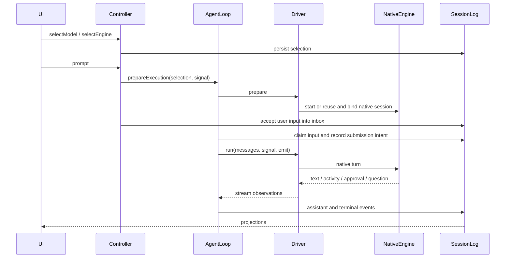

# 主对话引擎：实现与迁移参考

[English](main-agent-engines.md) | 中文

## 摘要

本机迁移功能、六个插件的安装与验证状态、可用版本标签和后续迭代检查见[功能迁移与迭代清单](../worktree-feature-list.md)。该清单同时区分当前实现、历史计划和外部启动配置；接手工具不能把设计稿中的旧待办当作当前缺失功能。

扩展或迁移原生、Claude Code、Codex 主对话之前，先通过本参考定位实现。本文提供功能到文件及符号的映射，区分引擎插件与共享运行时改动，并说明必须一起迁移的文件和持久化数据。完整配置字段以各包 README 为准。

## 目录

- [职责与入口](#ownership-and-entry-points)

- [功能索引](#feature-lookup)

- [端到端流程](#end-to-end-flow)

- [Claude 执行](#claude-execution)

- [Codex 执行](#codex-execution)

- [持久化与恢复](#persistence-and-recovery)

- [文件清单](#file-inventory)

- [迁移步骤](#migration-procedure)

- [验证与诊断](#verification-and-diagnosis)

- [原生子代理状态实现](#native-child-status-implementation)

- [子代理观察与续接定位](#child-observation-and-continuation-lookup)

- [失败处理与迁移依赖](#failure-handling-and-migration-dependencies)

- [子代理与恢复路径的验收范围](#acceptance-scope-for-child-and-recovery-paths)

<a id="ownership-and-entry-points"></a>

## 职责与入口

生产集成使用 `ReactLoopAgent` 配合 `EngineTurnDriver`。Harness 负责输入接纳、中止、生命周期、会话事件及客户端投影；外部引擎负责自身的模型与工具循环。原生工具活动用于展示和记录，不会作为 Harness 工具再次执行。

引擎包位于 `packages/subagent/`，但 `./startup` 导出注册的是主引擎。已有 `src/index.ts` 委派 API 和兼容类 `ClaudeMainAgent` / `CodexMainAgent` 是不同入口；仅修改这些包装类不会改变生产主对话。

| 层级 | 文件／归属 | 职责 |
|---|---|---|
| 共享内核 | [agent](../packages/core/agent/src/engines.ts)、[agent-loop](../packages/core/agent-loop/src/agent.ts)、[session](../packages/core/session/src/types.ts) | 引擎注册表、轮次驱动器、外部轮次生命周期、持久化事件。 |
| 引擎插件 | [Claude startup](../packages/subagent/subagent-claude-code/src/startup.ts)、[Codex startup](../packages/subagent/subagent-codex/src/startup.ts) | 进程管理、SDK／RPC 转换、原生存储、路由对应的配置。 |
| 主机服务插件 | [session-controller](../packages/api/session-controller/README.zh.md)、[permission-presets](../packages/interaction/permission-presets/README.zh.md)、[user-approval](../packages/interaction/user-approval/README.zh.md) | 串行化选择与发送命令、策略解析、人工决策。 |
| 厂商／UI 插件 | LLM 厂商适配器、模型设置、模型选择、聊天活动 | Endpoint 发现、凭证引用、选择控件、原生活动展示。 |
| 部署配套 | [web-app bundle](../packages/bundle/web-app/README.zh.md)、[app-boot](../packages/boot/app-boot/README.zh.md)、[config-editor](../packages/boot/config-editor/README.zh.md) | 激活插件，确定 profile 与共享配置的归属。 |

<a id="feature-lookup"></a>

## 功能索引

以下路径相对于仓库根目录。符号用于定位修改入口，不绑定容易变化的行号；修改公开 API 时同时检查调用者。

| 功能 | 文件与符号 | 联动调用方 |
|---|---|---|
| 注册主引擎 | [packages/core/agent/src/engines.ts](../packages/core/agent/src/engines.ts) — `AgentEngineDefinition`, `EngineTurnDriver` | 引擎 `startup.ts` → `registerClaudeEngine`／`registerCodexEngine`；`ReactLoopAgent`。 |
| 准备／执行／关闭 | [packages/core/agent-loop/src/agent.ts](../packages/core/agent-loop/src/agent.ts) — `prepareExecution`, `externalTurn`, `closeExecution` | 驱动器 `prepare`、`run`、`close`；共享收件箱与 assistant 流。 |
| 引擎锁定与历史默认 | [packages/api/session-controller/src/agent.ts](../packages/api/session-controller/src/agent.ts) — `engineFromEvents`, `engineForSession`, `createOrAdopt` | `commands.ts` → `selectEngine`；选择投影与客户端 directory。 |
| 模型／厂商选择与发送接纳 | [packages/api/session-controller/src/commands.ts](../packages/api/session-controller/src/commands.ts) — `selectModel`, `selectEngine`, `prompt`, `cancel` | Agent 控制器 `selectionFor`、`selectForNextRequest`；驱动器准备。 |
| 主机 /model 命令 | [packages/api/session-controller/src/model-command.ts](../packages/api/session-controller/src/model-command.ts) — `modelCommand` | `src/index.ts` 注册；UI 装饰同一个命令。 |
| 模型与引擎弹窗 | [packages/client/ui-model-selection/src/client/directory.ts](../packages/client/ui-model-selection/src/client/directory.ts) — `ModelDirectory`, `engineLocked`, `filterCatalogGroups` | `EngineSelect.tsx`、`index.ts` → `optionsOf`、`selectionOf`、`slots.ts`。 |
| 按引擎过滤模型目录 | [packages/api/session-controller/src/index.ts](../packages/api/session-controller/src/index.ts) — `modelCatalog`, `engineCatalog` | LLM endpoint 元数据及 `llm/src/types.ts` 的 `modelServesEngine`。 |
| Token 用量与上下文容量 | [packages/core/agent-loop/src/agent.ts](../packages/core/agent-loop/src/agent.ts) — `externalTurn`, `publishEngineContext`；[engines.ts](../packages/core/agent/src/engines.ts) 的 `EngineTurnDriver.contextWindow` | 用量随 `assistant/message` 结算；容量写入 `request/context`；两者经 token-meter 投影驱动输入框下方的统计与上下文用量表。 |
| Claude 路由与进程重启 | [packages/subagent/subagent-claude-code/src/engine.ts](../packages/subagent/subagent-claude-code/src/engine.ts) — `ClaudeExecutionDriver.prepare`, `registerClaudeEngine` | `endpoint.ts` → `resolveClaudeEndpoint`；`main-adapter.ts`。 |
| Claude SDK 流与中止 | [packages/subagent/subagent-claude-code/src/main-adapter.ts](../packages/subagent/subagent-claude-code/src/main-adapter.ts) — `ClaudeMainAdapter.start`, `runTurn`, `interrupt`, `close` | 驱动器回调、SDK Query、subprocess 服务。 |
| Claude 表单与 URL 确认 | [packages/subagent/subagent-claude-code/src/elicitation.ts](../packages/subagent/subagent-claude-code/src/elicitation.ts) — `answerClaudeElicitation` | 用户提问服务；SDK elicitation 回调。 |
| Codex 复用与启动 | [packages/subagent/subagent-codex/src/engine.ts](../packages/subagent/subagent-codex/src/engine.ts) — `CodexExecutionDriver.prepare`, `registerCodexEngine` | Endpoint、厂商配置、目录、存储；可更新的 `turnOptions`。 |
| Codex 厂商覆盖参数 | [packages/subagent/subagent-codex/src/provider-config.ts](../packages/subagent/subagent-codex/src/provider-config.ts) — `CodexProviderOptionsSchema`, `resolveCodexProviderSpec` | 驱动器签名、子进程环境、CLI `-c` 覆盖。 |
| Codex 原生模型目录 | [packages/subagent/subagent-codex/src/model-catalog.ts](../packages/subagent/subagent-codex/src/model-catalog.ts) — `resolveCodexModelCatalog`, `writeCodexModelCatalog` | `main-wire.ts` 初始化验证 `model/list`；驱动器记录目录内容。 |
| Codex 每会话原生存储 | [packages/subagent/subagent-codex/src/storage.ts](../packages/subagent/subagent-codex/src/storage.ts) — `prepareCodexHome` | 驱动器设置 `CODEX_HOME`、`CODEX_SQLITE_HOME`；恢复 rollout 路径。 |
| Codex JSON-RPC 与流 | [packages/subagent/subagent-codex/src/main-wire.ts](../packages/subagent/subagent-codex/src/main-wire.ts) — `CodexMainWire.start`, `initialize`, `startThread`, `runTurn`, `interrupt`, `close` | `main-adapter.ts` 管理子进程；驱动器授权／提问回调。 |
| 输入账本与投递不确定 | [packages/core/agent/src/engine-records.ts](../packages/core/agent/src/engine-records.ts) — `pendingEngineInputs`, `acknowledgeUncertainEngineInputs` | 外部轮次事件；驱动器准备补记未结算输入。 |
| 原生身份、脱敏、活动 | [packages/core/agent/src/engine-records.ts](../packages/core/agent/src/engine-records.ts) — `nativeBindingFor`, `recordNativeBinding`, `engineFailure`, `engineActivityRecorder` | 两个驱动器；聊天 `engine-activity.ts` → `registerEngineActivity`。 |
| Web／Desktop 共享设置 | [packages/boot/config-editor/src/index.ts](../packages/boot/config-editor/src/index.ts) — `ConfigEditor.sections`, `inherited`, `save` | `sharedEntries`；app-boot `readProfilePatches`；共同的 `DSH_HOME`。 |
| Team MCP 桥接 | [packages/subagent/subagent-in-process-driver/src/team-tool-bridge.ts](../packages/subagent/subagent-in-process-driver/src/team-tool-bridge.ts) — `startTeamToolBridge` | 两个引擎驱动器按轮次允许及等待调用结束；目录与结果使用 `engine/item-settled`。 |
| 持久外部子会话 | [packages/subagent/subagent-in-process-driver/src/index.ts](../packages/subagent/subagent-in-process-driver/src/index.ts) — `registerEngineSubagentProvider` | 引擎启动注册 `engine:claude`／`engine:codex`；委派工具接受引擎及模型选择。 |
| Agent Team 子智能体模型路由 | [packages/experimental/tool-agent-team/src/index.ts](../packages/experimental/tool-agent-team/src/index.ts) — `spawn_teammate` | 显式指定的厂商／模型对原样传给子智能体；两者都省略时继承 Lead 路由。Claude 在缺少可选元数据时保留选定名称；Codex 将未列出的选定名称加入原生目录。 |
| 冷子会话配置 | [packages/subagent/subagent/src/continuation.ts](../packages/subagent/subagent/src/continuation.ts) — `usingChildAgent` | Session Controller 通过所属生命周期借用可持续子会话，不提交模型轮次。 |
| 原生技能根目录 | [packages/subagent/subagent-in-process-driver/src/skill-directories.ts](../packages/subagent/subagent-in-process-driver/src/skill-directories.ts) — `syncEngineSkillDirectories` | 两个引擎链接有序技能根目录；Codex `skills/list` 提供精确调用路径。 |
| Codex 设置快照 | [packages/subagent/subagent-codex/src/user-config.ts](../packages/subagent/subagent-codex/src/user-config.ts) — `readSessionCodexUserConfig` | 同一已加载 Session 在切换模型与厂商时使用初始原生设置。 |

<a id="end-to-end-flow"></a>

## 端到端流程

三个引擎选项始终显示。尚未接纳任何用户输入时，会话可以反复切换引擎；接纳后仅当前引擎可选，即使可见 user-message 事件尚未产生，持久化收件箱中的已接纳输入也会锁定引擎。有消息而没有引擎选择记录的历史会话按原生处理。重新打开空会话时忽略旧的外部引擎草稿选择，允许重新选择。

外部会话必须空闲才能切换模型／厂商。控制器校验引擎 endpoint，更新下一次请求的选择，并单独保存未来会话的默认值。带参数的 `/model` 使用同一路径；客户端不带参数的 `/model` 打开共用模型弹窗。命令文本不会作为模型提示词发送。



准备阶段作为可中止的维护操作，在持久化接纳输入之前执行。因此 endpoint、配置或启动失败不会把空草稿变成已接纳消息的会话。输入接纳后，由共享循环负责轮次与终态记录。

授权和提问限定于当前原生轮次。Claude SDK 回调和 Codex 服务端请求调用 Harness 交互服务，再将答复映射回原生协议值。中止会使待处理交互失效，打断当前管理的原生轮次；进程无响应时执行有时限的清理。

<a id="claude-execution"></a>

## Claude 执行

配置详见 [Claude 包参考](../packages/subagent/subagent-claude-code/README.zh.md)。`startup.ts` 校验部署参数；`ClaudeExecutionDriver.prepare` 先解析所选 Anthropic 兼容 endpoint 和凭证，再创建 `ClaudeMainAdapter`。

| Harness 设置 | 原生映射／生命周期 |
|---|---|
| 所选厂商／模型 | Anthropic 路由凭证和 SDK model 参数；选择、endpoint、effort、策略或别名变化时先关闭旧进程，再启动替代进程并恢复原生会话。 |
| CLI 可执行文件 | 显式 `pathToClaudeCodeExecutable`，其次 PATH 的 `claude`，再其次 `~/.npm-global/bin/claude`，最后 SDK 自带程序。 |
| 模型后缀 `[1m]` | 设置 `CLAUDE_CODE_AUTO_COMPACT_WINDOW=1000000`；其他模型移除此变量，包括继承值。 |
| Effort | `CLAUDE_CODE_EFFORT_LEVEL` 遵循显式配置；`[1m]` 不隐含 `max`。 |
| `providers[provider].opusModel / sonnetModel / haikuModel / subagentModel` | 对应 `ANTHROPIC_DEFAULT_OPUS_MODEL`、`ANTHROPIC_DEFAULT_SONNET_MODEL`、`ANTHROPIC_DEFAULT_HAIKU_MODEL`、`CLAUDE_CODE_SUBAGENT_MODEL`；未配置的映射优先使用显式部署 env，再使用所选模型。 |
| 权限 | 会话权限预设是唯一权限来源：完全权限且不询问映射为 `bypassPermissions`，工作区修改映射为 `acceptEdits`，其它预设保持原生默认并通过 `canUseTool` 路由到 approval 服务。引擎不读取宿主机 `~/.claude/settings.json`。受限沙箱需要原生隔离；只读模式允许支持的读取／提问工具。 |

别名映射影响 Claude 原生别名及内部 subagent，不会在 Harness 模型目录中创建条目。Claude 通过 `CLAUDE_CONFIG_DIR` 使用 `$DSH_HOME/engines/claude`。指令加载与原生 CLI 一致：全部三个设置层级都会加载，且宿主机的 `~/.claude/CLAUDE.md` 会镜像进该配置目录，使用户级指令生效；引擎不读取宿主机 `settings.json`。恢复已接纳消息的会话必须有原生会话绑定；驱动器不会通过重放 Harness 消息来重建丢失的原生历史。

`answerClaudeElicitation` 支持简单类型表单及 URL 确认。嵌套表单和 secret／password／write-only 字段会被拒绝；不支持的通用 SDK 对话框会被取消。工具输入输出有长度上限，活动更新节流可配置。

已结算 result 的 `modelUsage` 会报告当前模型的 `contextWindow`；适配器保留该值，loop 将变化记录为 `request/context`。新适配器在首个 result 之前没有可报告值，因此恢复的会话沿用其最后一条持久化容量记录。

<a id="codex-execution"></a>

## Codex 执行

完整厂商字段详见 [Codex 包参考](../packages/subagent/subagent-codex/README.zh.md)。一个共享的 app-server 子进程服务所有普通会话：它在进程启动时初始化，每个对话以原生线程挂载到它上面。代理作用域携带 Harness Team 工具的会话保留专用的按会话子进程，因为其按代理的 MCP 桥接需要私有进程。多个会话可在共享子进程上并发运行；不承诺同一个 Harness 会话支持并发写入者。

| 输入 | 原生映射／重启条件 |
|---|---|
| 厂商路由 | 路由在共享子进程启动时由 `providers` 映射与 `provider` 字段注册；每条路由获得 `model_providers.dsh_engine_<n>` 与自己的私有凭证环境变量名，会话线程通过原生 `modelProvider` 字段选择路由。会话选择未注册路由时失败并列出已注册路由。启动覆盖通过 CLI `-c` 传递，不要求生成 `config.toml`。专用 team 会话子进程保留单一 `dsh_engine` 厂商。 |
| 仅模型变化 | 路由、effort、策略与线程设置均未变化时，更新 `turnOptions.model`；下一次 `turn/start` 接收新模型，不重新挂载。 |
| 启动元数据变化 | 配置或凭证漂移会在轮次之间重启共享子进程，随后每个会话通过 `thread/resume` 重新挂载线程；与进行中原生轮次冲突的变化会让正在准备的轮次大声失败，待其结束后重试。专用 team 会话子进程保留按会话替换与恢复；模型特定的厂商覆盖可能导致同厂商切模型时也触发替换。 |
| HTTP 参数 | `httpHeaders`、`headerCredentialRefs`、`queryParams`、重试次数、流超时及 websocket 支持在 `resolveCodexProviderSpec` 中解析；请求头值通过私有 env 传递，argv 只携带引用。 |
| 模型覆盖 | 指令、上下文窗口、自动压缩阈值、截断预算、推理摘要支持／样式及详细程度；`models[exactModelId]` 覆盖厂商默认值。路由级模型固定值只进入共享目录，不会成为进程级默认。 |
| 内部 subagent | `subagentModel`、`subagentReasoningEffort` 映射为 `agents.default_subagent_model`、`agents.default_subagent_reasoning_effort`；这些属于 Codex 内部 agent，在进程级只携带一份，因此各路由必须取值一致。 |
| 权限 | 会话权限预设是唯一权限来源并决定每个线程字段：沙箱映射为原生 sandbox；询问 → `on-request` 加 reviewer `user`；不询问 → `never`；自动 → `on-request` 加 `auto_review`。权限切换通过 `thread/resume` 以新的原生值重新挂载共享线程。引擎不读取宿主机 `~/.codex/config.toml` 或 `~/.codex/rules`。原生命令／文件／权限授权请求通过 approval 服务转换。 |

共享原生目录为 `$DSH_HOME/engines/codex/shared-home`；`CODEX_HOME` 和 `CODEX_SQLITE_HOME` 承载该进程共享的 SQLite 与日志状态。更早的 rollout 只读迁移，先从遗留根目录、再从该会话旧的按会话目录拷贝，已提交的生成物只会被拷贝、不会被移动；专用 team 会话目录仍在 `$DSH_HOME/engines/codex/session-homes/<sha256(HarnessSessionId)>`。引擎在每次准备时把宿主机的 `~/.codex/AGENTS.md` 镜像进该目录，使全局指令像直接运行 CLI 一样被加载；部署字段 `mirrorUserInstructions: false` 可关闭镜像。部署 `env` 不能覆盖保留的路由／存储环境变量；诊断会对已解析凭证脱敏。

共享子进程每次启动会解析每条已注册路由的目录，并合并为一份原生 `{models:[...]}` JSON；同一个模型 ID 被两条路由提供时启动失败。路由列表缺少显式选定名称时原样加入该名称，并按路由保留先前选定的未列出名称，在不重启子进程的情况下原地刷新共享目录元数据。可用时使用模型元数据；未列出的路由无法解析元数据时以选定名称作为目录名称。子进程初始化时仍须通过 `model/list` 返回每个预期 ID；缺少 ID 或提供方目录不可用时启动失败。

`writeCodexModelCatalog` 以原子方式把 `models.json` 写入共享目录，权限为 0600，启动时以绝对路径传递 `model_catalog_json`。共享子进程初始化时通过分页 `model/list` 一次性验证所有预期 ID；畸形答复、重复游标、缺失模型均导致启动失败。驱动器在接纳提示词之前将实际目录内容记录到每个会话日志。

原生目录与 Harness `/model` 职责不同：前者配置 app-server 对模型的认知；后者更新会话选择，从而更新下一次 `turn/start`。仅写入 `models.json` 不会选择模型。

`thread/tokenUsage/updated` 携带本轮 token 用量，并在运行时报告时携带 `modelContextWindow`；wire 保留该容量值，驱动器则以准备好的目录中所选模型解析出的 `context_window` 兜底。

<a id="persistence-and-recovery"></a>

## 持久化与恢复

事件声明位于 [session types](../packages/core/session/src/types.ts)，语义和调用方位于 `engine-records.ts`、`ReactLoopAgent.externalTurn`。这些属于已发布会话数据；修改时遵守 [会话格式状态](session-format-status.zh.md) 和 [持久化类型评审](cookbook/reviewing-persistence-type-changes.zh.md)。

| 持久化记录 | 开发／迁移用途 |
|---|---|
| `engine/selected` | 所选引擎；结合已接纳用户历史决定锁定／默认行为。 |
| `engine/input-submitted` | 投递意图：`inputId`、`attemptId`、`contentRef`、`operation`；关联原生投递与已接纳 Harness 输入。 |
| `engine/item-settled` | `nativeItemId`、`revision`、`category`、`payload`；包含原生绑定、活动及 Codex 模型目录记录。 |
| 绑定 payload | `engineId`、`nativeSessionId`、`cwd`；必须匹配原生存储及工作目录。 |
| `engine/turn-settled` | `turnId`、`outcome`；用于恢复核算的执行终态事实。 |

已派发但未到达终端原生结算的输入会结算为 `acknowledged-uncertain`：失败回合被观察到时立即记录，写入进程崩溃后由驱动器准备补记。引擎的原生历史保持权威——输入不会重放，下一次提示从该历史恢复。确认既不重建缺失的原生历史，也不保证该输入已被投递。

Codex 恢复优先使用已有私有 rollout。旧共享存储只在校验 UUID、首行会话元数据及 cwd 后导入匹配的 rollout；保留源文件，不复制其他会话、auth、config 和数据库。已接纳消息的历史缺失或歧义会明确报错。没有 rollout 的空原生草稿可以新建线程。恢复使用显式 rollout 路径，并检查返回的线程 ID。

<a id="file-inventory"></a>

## 文件清单

本清单按职责归类集成涉及的文件。它是迁移索引，不表示工作区中所有未提交文件都属于此功能。每行列出的路径共享该行的包前缀。

| 包／区域 | 需要检查或携带的文件 | 联动原因 |
|---|---|---|
| `packages/core/agent/` | `src/{engines,engine-records,index,model-selection,runtime-types,types}.ts` | 驱动器 API、持久化账本辅助函数、导出类型与选择调用方。 |
| `packages/core/agent-loop/`, `packages/core/session/` | `src/agent.ts`; `src/types.ts` | 外部轮次生命周期与事件声明；修改时更新 SDK 投影。 |
| `packages/api/session-controller/` | `src/{agent,commands,engine-selection-projection,index,model-command,types}.ts`, `tsconfig.host.json` | 接纳、默认值、命令注册及客户端投影共同构成选择路径。 |
| `packages/api/gateway/` | `src/client/index.ts` | 主机选择状态的客户端 API 调用方。 |
| `packages/subagent/subagent-claude-code/` | `src/{startup,engine,endpoint,main-adapter,elicitation,index}.ts`, `package.json`, `tsconfig.json` | 生产 startup 导出、驱动器、SDK 适配器、路由解析及表单；保留共用委派依赖。 |
| `packages/subagent/subagent-codex/` | `src/{startup,engine,endpoint,provider-config,storage,model-catalog,main-adapter,main-wire,index}.ts`, `package.json`, `tsconfig.json` | 厂商配置、私有存储、原生目录及协议协商必须一起迁移。 |
| `packages/llm/llm/` | `src/types.ts` | Endpoint 能力及每模型路由元数据。 |
| `packages/llm/llm-deepseek/`, `llm-deepseek-api-key/` | `src/{adapter,config,host,types}.ts`; API-key `src/index.ts` | Claude／Codex URL、endpoint 发现及后端凭证引用。 |
| `packages/llm/llm-pi-ai/` | `src/{adapter,config,index}.ts` | 自定义厂商引擎 endpoint 与凭证。 |
| `packages/interaction/permission-presets/`, `user-approval/` | `src/index.ts` | 权限策略解析及限定轮次的交互生命周期。 |
| `packages/client/ui-model-selection/` | `src/client/{EngineSelect.tsx,EngineSelect.module.css,directory.ts,index.ts,slots.ts}` | 始终显示的引擎选项、模型目录、命令弹窗及锁定投影。 |
| `packages/client/ui-settings-models/` | `src/client/{CustomProviderCard,ProviderEditor}.tsx`, `src/client/locales.ts` | Endpoint 设置 UI 与本地化标签；`locales` 为 `.ts`。 |
| `packages/client/ui-commands/` | `src/client/{resolution,presentation,locales}.ts` | 内置 `/model` 标识、展示及本地化。 |
| `packages/client/ui-chat/` | `src/client/conversation-nodes/{engine-activity,register}.ts` | 原生活动解析与贡献注册。 |
| `packages/boot/app-boot/`, `config-editor/` | `src/profile-context.ts`; config-editor `src/index.ts`, `package.json` | 共享 home 补丁组合与配置编辑器读写归属。 |
| `packages/bundle/web-app/` | `cordis.patch.yml`, `package.json` | 插件激活、共享条目选择及解析器依赖。 |
| Build / generated consumers | `pnpm-lock.yaml`, `scripts/{gen-cordis-catalog.ts,type-equiv.manifest.json}`, `packages/extensions/tool-cordis/src/api-catalog.ts` | 依赖锁定、声明类型镜像及生成 API 调用方；重新生成所属目录。 |

配置共享独立于引擎选择。Boot 组合 bundle 层、profile 补丁、共享 home 补丁和命令覆盖。`ConfigEditor.sharedEntries` 决定哪些条目写入 home。Web／Desktop 必须使用同一个 `DSH_HOME`，并各自激活所需插件；共用目录不会自动激活插件或提供平台专属服务。

<a id="migration-procedure"></a>

## 迁移步骤

本步骤适用于将集成移植到其他代码树或重构职责归属。全程保留生产驱动器路径；配置查阅包参考，不把 scratch 计划直接当作可执行操作说明。

1. 先映射目标生命周期：注册表、下一请求选择、接纳前可中止准备、持久化收件箱、流持久化、中止及释放。共享内核声明与全部 TypeScript／Python SDK 调用方一起迁移；已发布事件变化走持久化确认流程。

2. 先迁移 endpoint 元数据和凭证服务，再迁移引擎启动。确保每个配置厂商暴露自己的 Claude 和／或 Codex URL 及模型兼容信息。外部 endpoint 缺失时不能使用原生默认 URL 代替。

3. 每个引擎的 startup 导出、驱动器和适配器连同包清单及官方 SDK／CLI 依赖一起迁移。Claude 还需 elicitation；Codex 还需厂商配置、存储、目录及 JSON-RPC 初始化。保留子进程归属与先关闭再替换的行为。

4. 控制器选择、历史／默认规则及投影，与 UI 设置、引擎／模型控件、`/model` 命令装饰一起迁移。分别核对空草稿、已有消息的历史会话、忙碌会话拒绝及未来会话默认值。

5. 将 Harness 日志、原生身份绑定、原生对话文件作为一个恢复单元保存。保留 cwd 身份，或制定显式重定位流程；不能静默改写绑定。复制 Codex 私有 home，或使用已校验的旧存储导入器。保护 Claude 原生会话存储，不能用无关的用户 CLI home 代替。

6. 组合受支持的 `dsh` profile 及解析器依赖。Web／Desktop 共享时迁移 app-boot／config-editor 共享条目支持，并检查两个 profile 的服务可用性。启动迁移后的 profile 前构建受影响的 host 与 client 产物。

7. 针对修改归属运行行为检查、归属包快照、host／client 类型检查及构建路径检查。真实验收覆盖直接使用配置 endpoint、切模型、权限、中止和关闭／恢复；每个测试进程／home 与用户活跃会话分开。

8. 文件或职责迁移时更新本文功能／文件映射和双语版本。配置变化更新包 README，AgentLoop 扩展变化更新架构文档，声明 API 变化更新生成参考。

<a id="verification-and-diagnosis"></a>

## 验证与诊断

验收证据有明确范围：Claude 使用已配置的 DeepSeek Anthropic 兼容 endpoint 完成真实多轮及关闭／恢复调用。Codex 使用官方 Codex 0.153.4 直接调用已配置的 DeepSeek Codex endpoint，验证生成目录对应的 `model/list`，在同一进程从 `deepseek-flash` 切换到 `deepseek-v4-pro`，关闭后恢复并保留记忆。这些结果不代表全部原生工具授权路径或所有平台都已验收。

Codex 目录／厂商／存储／驱动器的针对性回归覆盖 30 项通过测试；直接主引擎验收入口为 [main-loader.e2e.ts](../packages/subagent/subagent-codex/tests/main-loader.e2e.ts)。较早的 `real-deepseek.e2e.ts` 通过测试协议桥接验证委派，不能作为主引擎直接 endpoint 支持的证据。

针对性检查位于所属包附近：Codex `tests/{model-catalog,main-catalog-wire,provider-config,storage,engine,engine-endpoint}.spec.ts`；session-controller 管理模型命令预期，包括 `tests/expected/model-command.txt`。快照及构建产物要求查阅 [测试策略](testing.zh.md)，不要默认运行全套测试。

| 现象 | 首先检查 |
|---|---|
| 只显示原生引擎 | Profile 激活／解析器清单、引擎注册表、实际提供的客户端产物、`engineCatalog` 及客户端 directory。 |
| 首条消息前新会话失败 | 控制器准备错误；所选 endpoint、凭证引用、权限服务及原生启动日志。 |
| 切厂商仍使用旧 URL | 驱动器进程签名及关闭／启动完成情况；不能依赖原生 URL 热更新。 |
| Codex 模型缺失或被拒绝 | 厂商／模型兼容信息、`models.json`、启动目录路径及已验证的 `model/list`。 |
| 恢复历史丢失或被拒绝 | 绑定的引擎／ID／cwd、原生 rollout 身份及私有 home；重放前检查不确定输入账本。 |
| Desktop 设置／插件不同 | 实际 `DSH_HOME`、config-editor `sharedEntries`、两个 profile 层及平台所需服务。 |

外部引擎仍不支持附件、steering 和 fork。本集成没有提供覆盖所有原生 MCP／hooks／skills 定制的完整 UI。原生内部 subagent 模型设置不用于配置 Harness 委派插件。

## 延伸阅读

- [架构](architecture.zh.md) 和 [核心子系统](subsystems/core.zh.md)：共享运行时归属。

- [Claude 包](../packages/subagent/subagent-claude-code/README.zh.md) 和 [Codex 包](../packages/subagent/subagent-codex/README.zh.md)：配置与适配器限制。

- [端到端计划](scratch/main-agent-engines/end-to-end-plan.zh.md)：计划背景；开发以本参考与当前包文档为入口。

- [持久多引擎 Agent Teams 设计](scratch/main-agent-engines/persistent-agent-teams.zh.md)：成员执行预设、Session 唤醒、团队工具桥接及实现任务提案。

<a id="native-child-status-implementation"></a>

## 原生子代理状态实现

内部子代理依次经过 `packages/core/agent/src/engine-records.ts` 的 `engineSubagentRecorder`、`engine/item-settled` 观察记录、`packages/experimental/agent-team/src/engine-subagent-projection.ts` 的 `engineSubagents` 投影，以及 `packages/experimental/client-ui-agent-team/src/client/` 的 `EngineSubagents`、`RosterGroups` 和 `MemberCard`。Claude 的 `ClaudeMainAdapter.observe` 消费 SDK 任务生命周期和子代理消息；Codex 的 `CodexMainWire.observeChildren` 消费协作 item 和已知子线程通知。现有 Session 投影传输提供重放和实时快照。这些记录不新增 Harness 子 Session 或模型可见输入。协议限制和配置详见对应包的参考文档。

Claude 后台子代理在父轮次之间完成时，通过 `ClaudeMainAdapter` 的 `onBackgroundSubagentComplete` 回调与驱动的 `agent.followup` 投递，排队写入一条以原生工具调用为来源的持久化用户角色消息。父循环沿用输入账本和流式通道继续回复。前台 Agent/Task 结果直接结算子代理状态，后台启动确认仍保持运行中。`TeamAction` 是团队控件、Harness 子 Session 和已观察引擎子代理共用的唯一标题栏入口；Team 投影存在时，它取代独立的子智能体计数入口。面板保留嵌套 Session 导航与操作、可展开的只读原生子代理输出、成员状态及共享任务。没有 Team 投影的普通会话仍显示独立入口。

<a id="child-observation-and-continuation-lookup"></a>

## 子代理观察与续接定位

迁移原生子代理展示或排查子代理完成后主模型未续接时，先查此映射。[团队 UI 参考](../packages/experimental/client-ui-agent-team/README.zh.md)负责展示、时间和分类；[个人助理参考](../plugins/dsh-personal-assistant/README.zh.md)负责固定会话和恢复。

| 归属 | 文件 / 符号 | 开发职责 |
|---|---|---|
| 共享 agent API | `packages/core/agent/src/types.ts`：`EngineSubagentRecord`、`EngineSubagentPatch`；`src/engine-records.ts`：`engineSubagentRecorder` | 用修订号持久化受长度限制的原生子代理观察，回放已有记录，将断连时运行的子代理标记为未知。 |
| Claude 插件 | `packages/subagent/subagent-claude-code/src/main-adapter.ts`：`ClaudeMainAdapter.observe` | 关联 Agent/Task 调用、SDK 任务事件、子代理消息与结构化工具结果，区分前台完成和异步启动确认。 |
| Claude 插件 | `packages/subagent/subagent-claude-code/src/engine.ts`：`onBackgroundSubagentComplete` 回调 | 已知后台子代理在主模型轮次之间完成时，由当前驱动排入普通的、持久化的工具来源续接消息。 |
| Codex 插件 | `packages/subagent/subagent-codex/src/main-wire.ts`：`CodexMainWire.observeChildren` | 观察协作条目和已知子代理通知，映射原生状态，通过现有主会话授权处理子代理交互。 |
| Team Host 插件 | `packages/experimental/agent-team/src/engine-subagent-projection.ts`：`engineSubagentProjection`；`src/index.ts` | 使用现有 Session 投影传输注册可回放的 `engineSubagents` 投影。 |
| Team Client 插件 | `packages/experimental/client-ui-agent-team/src/client/{TeamAction,TeamDashboard,EngineSubagents,Roster,TaskTiming}.tsx`；`mount.ts` | 共享状态列表、时间和只读原生输出，通过统一的外部子代理/Team 标题栏入口手工打开侧栏。 |
| 原生循环 | `packages/core/tools/src/index.ts`：`TOOL_RUNTIME_SCHEDULER`；`packages/core/agent-loop/src/tool-calls.ts`：`executeToolCalls`、`runGroup`、`appendSchedulerFailure` | 在兼容包副本间共享调度器服务键；内部调度失败时为尚未结束的调用记录结果。 |

观察记录使用现有 `engine/item-settled` 的 `subagent` 和 `subagent-disconnected` 分类，不引入新的 Session 代际或 MessageSource 类型。正常断连将待运行和运行中观察标记为未知；未记录断连的硬崩溃可能保留最后观察到的运行状态。重连保留首次开始时间，原生终态观察提供结束时间。协议未提供的进展或完整输出不推测补齐。

Claude 续接与状态观察分别处理。已知、非环境后台任务在主模型轮次结束后发出完成通知时，通过现有工具来源的 `agent.followup` 投递受长度限制的汇总，普通输入账本和主循环执行下一轮。主模型仍在运行时由 SDK 消费通知，不额外排入轮次。失败或停止通知不触发此完成回调。去重仅在进程内生效，不保证重启后恰好投递一次。驱动关闭时先撤销当前适配器，再等待退出，迟到通知不能唤醒已替换进程。

Codex 协作调用结束不代表子代理完成，状态由明确的原生子代理状态决定，缺失时保持待运行。恢复时从已恢复线程条目读取已知协作关系，将未确定的活动标记为未知。观察不会额外启动 app-server 或轮询任意原生线程。两个适配器都不为引擎内部子代理创建 Harness 子 Session，因此只读列表不能独立向它们发消息、中止或恢复。原生子 Session 导航插件仍是一项独立能力。

<a id="failure-handling-and-migration-dependencies"></a>

## 失败处理与迁移依赖

[原生循环](../packages/core/agent-loop/README.zh.md)等待已启动的工具调度结束，并在关闭步骤前为未结束的模型调用记录明确的 `TOOL_SCHEDULER_FAILED` 结果；原始异常仍使本轮失败。[tools 包](../packages/core/tools/README.zh.md)通过 `Symbol.for` 在兼容 runtime/profile 副本间共享调度器服务键。部署时需同时更新这些归属包，重建 UI 无法解决后端调度器不一致。此失败处理不修复已损坏的历史记录。

子代理观察需要整体迁移：共享 agent 记录类型和记录器、引擎适配器、Team Host 投影及 Team Client 构建产物。依赖客户端投影前需启用 Host Team 插件，保留本地化状态文案及现有 Session 投影传输。独立个人助理的 Host/Client 包需要其 README 所述的目录排除和共享对话壳能力。安装 Host 和 Client 产物后重启使用它们的 profile，确保两端使用同一实现。

诊断时需区分子代理状态与主模型续接、原生子代理身份与 Harness Session 地址、Session 日志有效性与独立助理任务存储。修改 UI 状态前先检查原生事件和投影；将主模型不汇总归因于列表组件前先检查 followup 与输入账本。替换助理会话保留任务存储和旧日志，但不恢复旧模型上下文。

<a id="acceptance-scope-for-child-and-recovery-paths"></a>

## 子代理与恢复路径的验收范围

近期子代理展示、调度器和助理恢复工作具备定向 TypeScript 构建、相关打包、翻译配对及空白检查证据。持久化声明检查通过，无需新的 Session 格式。Desktop/Web 安装及 Desktop 启动已检查，最终助理包避免了启动时引用已释放的错误。自动损坏恢复是在空任务集合下观察到的，因此该观察不能证明非空集合的保留已验收。

这些路径尚无近期回归测试、浏览器自动化或真实 Claude/Codex 验收证据；上文已有 endpoint 测试仅覆盖其所述的模型、目录和恢复范围。后续验收需覆盖前台与后台完成、主轮次交接期间完成、重复通知、进程替换、子代理状态缺失、子代理授权与提问、手工打开侧栏、多次运行时间、并发助理恢复、非空任务保留及无关历史加载错误。Codex 验收需隔离用户正在使用的进程和目录。


<a id="commands-context-and-images"></a>
## 命令、上下文占用及图片

| 功能 | 共享运行时及界面 | 引擎插件 |
|---|---|---|
| 斜杠命令目录 | `agent/src/types.ts` 中的 `AgentEngineCommand`；`SessionController.engineCommands`；ui-commands 的 `CommandUiRuntime` 合并引擎及 Host 条目，在选择变化后丢弃过期目录。 | Claude 驱动 `commands` 读取 SDK `supportedCommands` 及别名，包含带命名空间的技能。Codex 驱动通过 app-server 提供 `/compact`；`/model` 及权限选择使用 Harness 处理器。 |
| 命令执行 | `ReactLoopAgent.engineCommands` 获取目录时不重启运行中的轮次；动作执行需要空闲维护。提示词命令通过普通输入路径进入持久会话。 | Claude 将斜杠文本作为原生输入。Codex 的 `CodexMainWire.compact` 发送 `thread/compact/start`，接受空响应并等待原生轮次完成；取消会中止执行，并限制进程关闭等待。未映射 app-server 操作的 TUI 命令不在目录中展示。 |
| 占用率 | token-meter 的 `contextPressureProjectionDefinition` 跟踪请求路由，切换时清除旧样本，并以该路由的容量计算报告压力的占用率。`ContextMeter` 对外部引擎隐藏 Harness 估算分类。 | Claude 将最新主模型提示词大小记录为 `TokenUsage.contextInputTokens`，另外保留累计计费用量。Codex 从总输入中扣除缓存输入，再发布互不重叠的计数。 |
| 图片 | Session Controller 检查模型图片能力并接纳持久附件。外部驱动通过附件服务读取图片字节；卸载后的图片使用占位文本。 | Claude 接收 base64 图像源块；Codex 在 `turn/start.input` 中接收图片 data URL。外部文件附件仍不支持。 |

迁移时，浏览器可用描述、Agent 驱动方法、Controller RPC 及生成的远程声明必须与 ui-commands 插件一起迁移。图片支持还依赖附件服务及引擎附件能力标志。上下文变更涉及 LLM 用量声明、token-meter 状态 schema 及两个原生用量适配器；旧投影检查点从会话日志重建。


<a id="engine-reasoning-mapping"></a>
## 引擎思考程度映射

思考程度解析由引擎定义参与，无需为浏览器增加独立组件。`LlmReasoningEffortInfo.wireValue` 提供 native 适配器映射；ui-model-selection 仍提交稳定的可选标识。`SessionController.modelCatalog` 和 `selectModel` 按精确厂商及模型调用 `resolveReasoning`，因此不支持的选项会被过滤，并在保存前拒绝。省略选择时使用配置的默认值；没有配置默认值时，取所提供等级中最强的 `xhigh`、`high`，两者都不提供时才不指定原生引擎的默认程度。 切换引擎时清除上一引擎的思考程度选择，由新引擎解析自己的默认值。

路由级 `reasoningEfforts` 和 `defaultReasoningEffort` 均可省略。精确 `models[modelId]` 字段覆盖路由默认值；明确映射会替换可选集合，也可使用 `minimal` 等标识并映射为 SDK 的 `low`。明确默认值必须属于可选集合。Claude 映射接受 SDK 程度值，null 表示关闭思考；Codex 接受 app-server 程度字符串，并将 null 转为 `none`。这些设置用于主模型，原有内部子代理设置保持独立含义。请将下方厂商及模型标识替换为已注册的标识，并使用目标引擎及端点支持的值。

```yaml
- name: '@deepseek-ai/dsh-subagent-claude-code/startup'
  config:
    providers:
      deepseek:
        models:
          'deepseek-flash[1m]':
            reasoningEfforts:
              off: null
              low: low
              high: high
              max: max
            defaultReasoningEffort: high
- name: '@deepseek-ai/dsh-subagent-codex/startup'
  config:
    providers:
      deepseek:
        models:
          'deepseek-flash[1m]':
            reasoningEfforts:
              off: null
              low: low
              high: high
              max: xhigh
            defaultReasoningEffort: high
```

### 实现定位

| 职责 | 文件及函数 |
|---|---|
| 适配器协议值 | `packages/llm/llm/src/types.ts` → `LlmReasoningEffortInfo`；`llm-pi-ai/src/adapter.ts` → `reasoningInfo`。 |
| 共享解析器 | `packages/core/agent/src/engine-reasoning.ts` → `EngineReasoningOptions`、`mapEngineReasoning`、`resolveEngineEffort`；`engines.ts` → `AgentEngineDefinition.resolveReasoning`。 |
| 目录及准入 | `packages/api/session-controller/src/catalog.ts` → `buildModelCatalog`；`index.ts` → `modelCatalog`；`commands.ts` → `selectModel`。 |
| 浏览器引擎目录 | `packages/client/ui-model-selection/src/client/catalog.ts` → `ModelCatalogDirectory.forEngine`；`directory.ts` → `ModelDirectory.syncInputs`。 |
| Claude SDK 设置 | `packages/subagent/subagent-claude-code/src/engine.ts` → `resolveClaudeReasoning`、`ClaudeExecutionDriver.prepare`；`startup.ts` → 厂商及模型 schema；`main-adapter.ts` → `buildOptions`。 |
| Codex 启动及轮次 | `packages/subagent/subagent-codex/src/provider-config.ts` → `resolveCodexReasoning` 及 schema；`model-catalog.ts` → `resolveCodexModelCatalog`；`engine.ts` → `CodexExecutionDriver.prepare`。 |

迁移时，持久标识保持不变。共享解析器、引擎配置 schema、目录及准入接线、驱动映射需要一起迁移。Codex 目录中的思考程度及每轮 effort 来自相同的准备后模型元数据。Claude 将解析后的程度及关闭模式纳入进程替换签名；Codex 将解析后的程度纳入签名。替换过程等待旧进程退出，并恢复原有原生标识。
