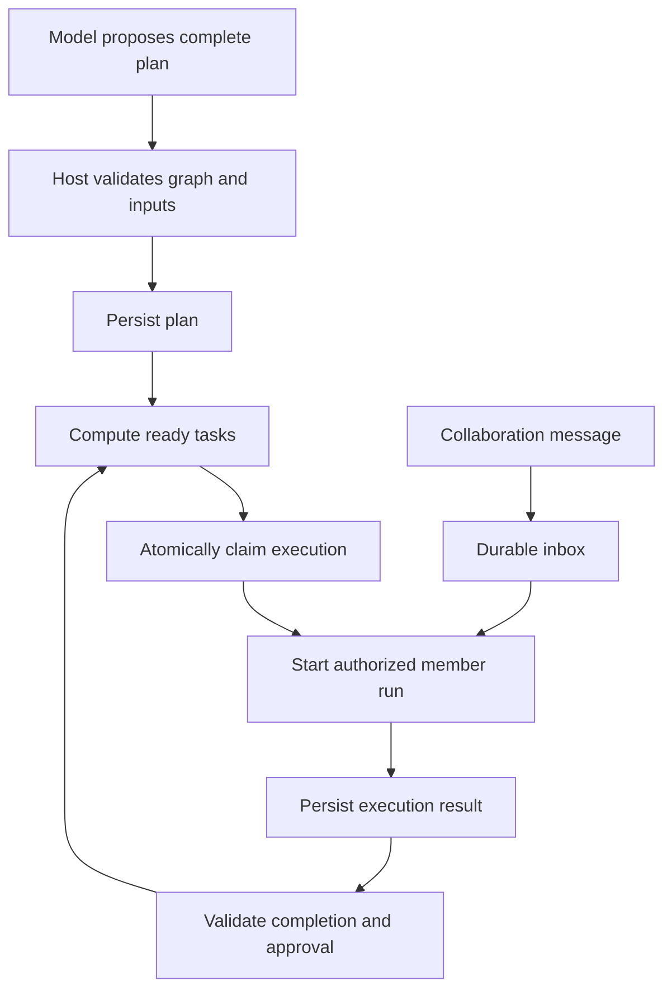

# Agent Team scheduling, execution validation and messaging design

English | [中文](agent-team-controlled-scheduling.zh.md)

## Table of contents

- [Summary](#section-1)
- [Existing capabilities and related designs](#section-2)
- [Responsibilities and execution flow](#section-3)
- [Plans, dependencies and completion conditions](#section-4)
- [Unified startup validation and atomic claims](#section-5)
- [Messages, assignments and stopping](#section-6)
- [Delivery by member state](#section-7)
- [Execution authorization and engine enforcement](#section-8)
- [Automatic scheduling, recovery and observability](#section-9)
- [Implementation, compatibility and acceptance](#section-10)

<a id="section-1"></a>

## Summary

Status: implemented with bounded path and approval checks. Date: 2026-10-07. Models propose tasks, dependencies, assignees and collaboration messages. Host validates plans, derives eligibility, claims execution, starts members and recovers interrupted operations from durable state. The [feature list](../../../worktree-feature-list.md) records validation and limits.

The implementation prevents starting unready tasks, message-triggered scheduling bypasses and duplicate workflow creation. Assigned ready tasks schedule automatically after dependencies and user approval. Declared input paths must exist inside the task workspace before dispatch; declared outputs must exist inside the workspace and declared write scopes before completion. This file describes the implementation boundary and its remaining limitations.

<a id="section-2"></a>

## Existing capabilities and related designs

[task-view.ts](../../../packages/experimental/agent-team/src/task-view.ts) derives ready from completed prerequisites. [task-board.ts](../../../packages/experimental/agent-team/src/task-board.ts) checks dependencies for claims and related operations. [task-graph.ts](../../../packages/experimental/agent-team/src/task-graph.ts) validates graphs. [mailbox.ts](../../../packages/experimental/agent-team/src/mailbox.ts) already provides durable delivery and deduplication. Extend these owners rather than introducing another task board or mailbox.

The [immediate-dispatch proposal](agent-team-workflow-dispatch.md) combines checks, claims and wakeups. Its interrupt-then-message behavior, sequential plan creation and completion conditions are not sufficient safeguards here. This proposal requires atomic graph submission, durable startup claims and separate wakeup/execution authorization. Audit existing related code before applying this design. UI follows the [task flow design](team-panel-flow.md).

Service and tool dispatch, workflow creation, approval, engine callbacks and native Harness tools now check the same durable task state. The ready projection is for display; claims recheck eligibility inside the transaction.

<a id="section-3"></a>

## Responsibilities and execution flow

| Stage | Model responsibility | Host responsibility |
|---|---|---|
| Planning | Decompose work and declare dependencies, inputs, outputs and assignees. | Validate IDs, references, cycles and input/dependency consistency; persist the complete plan atomically. |
| Scheduling | Request execution or suggest priority. | Derive ready, check approval, concurrency and write-scope conflicts; claim execution. |
| Startup | Supply work instructions and explicit model selection. | Validate engine/configuration and create execution/member-run records. |
| Completion | Submit results and explanation. | Observe execution outcomes, validate completion and update authoritative state. |
| Collaboration | Send context, questions and discussion. | Persist, deduplicate, consume in order and enforce authorization. |
| Recovery | Explain problems and suggest repairs. | Reconcile processes/Sessions, revoke stale authorization and prevent uncertain automatic restart. |



Enqueuing a message does not authorize startup. Discussion and task execution have different authorization; execution turns always pass eligibility and claim checks.

<a id="section-4"></a>

## Plans, dependencies and completion conditions

Submit all known tasks at once, including waiting successors. Host validates unique IDs/stage names, existing prerequisites, no self-links/cycles, valid assignees and explicit inputs. Invalid plans reject entirely. Dependency changes use expectedRevision and coordinate transactionally with claims; claimed/running tasks cannot change dependencies.

Preserve the existing completed-prerequisite default initially. Add explicit completion gates: execution-success requires observed success plus configured output validation; user-accepted additionally requires user acceptance. Requested approvals become durable gates rather than Lead prompt conventions. Failure, stopping, process exit, deleted prerequisites and model completion prose do not satisfy dependencies automatically.

Tasks declare inputs, expected outputs and completion criteria. Referencing another task output requires its dependency. Startup verifies input availability; completion verifies mechanically checkable artifacts/test outcomes. Models may still omit business dependencies: software checks declared/observable conditions, not all business meaning. Unverifiable conditions retain human or model review gates.

Cancelled/failed prerequisites expose blocked successors and reasons rather than silently dropping dependencies. Reopening invalidates acceptance and recalculates successors; active successors must stop/end before prerequisite changes. Delivered results retain history.

<a id="section-5"></a>

## Unified startup validation and atomic claims

Model tools, UI actions, scheduling, message wakeups, retries and recovery use one Host startup entry. Managed execution members require taskId. Missing IDs create an independent task before checks, never bypassing through generic spawn. Member identities may exist without starting a process and remain visible while dependencies wait.

Startup checks pending state, satisfied dependencies, approvals, no cancellation, no valid claim/active execution, valid assignee/model, available inputs and resource limits together. The ready projection is display-only; claiming revalidates against current revisions to prevent eligibility-check races.

Host atomically persists executionId, taskId, memberId, requestId, task/plan revisions, claim state, owner, fencingGeneration and execution authorization before process startup. Identical requestIds return the original execution; altered payloads with the same ID reject. Claims have one winner, and resource slots are claimed centrally rather than counted independently by members.

Database commit and process creation cannot form one transaction. Execution states distinguish reserved, starting, running, ended, failed, stopped and startup-unconfirmed. A failure known to precede process creation can release its claim; a startup crash requires Session/process reconciliation before retry and exposes action needed when uncertain. Session identity must correlate with its execution attempt.

Concurrency, claim lifetime, retries and timeouts are schema-validated Config fields. Lease expiry alone does not permit another process: confirm the old execution stopped and increment fencingGeneration to invalidate old writes/tool authorization.

<a id="section-6"></a>

## Messages, assignments and stopping

| Proposed entry | Purpose | Host behavior |
|---|---|---|
| sendMessage | Context, questions and discussion. | Validate sender/member identity and enqueue durably without task authorization. |
| assignTask | Assign or request executable work. | Bind taskId, check ready and use unified scheduling. |
| requestStop | Stop the execution attempt. | Invoke process/engine stop directly, persist outcome and never wait for model message consumption. |

Existing tool names may remain but must follow these semantics. Message purposes context, question and discussion guide presentation/delivery, not trusted security decisions. Authorization cannot depend on detecting start-work wording.

Persist messageId, requestId, Team, sender, stable recipient member ID, optional taskId/executionId, purpose, content and time. Stable IDs prevent delivery to replacement same-name members. Permissions constrain all reading/sending; ordinary messages do not implicitly create execution.

Track accepted as durably saved, delivered as recorded in the target Session, consumed as claimed for actual input, and associated replies. Reuse existing mailbox acknowledgement fields where suitable. Delivery is not consumption, and consumption is not understanding/reply. External engines without consumption acknowledgement show only delivered. replyTo explicitly associates responses.

Use durable identities and consumer deduplication rather than promising cross-process exactly-once delivery. Recovery reconciles target writes with missing sender acknowledgements without generating repeated inputs. Maintain reconstructable per-recipient order, consuming task-bound messages only in their corresponding scope.

<a id="section-7"></a>

## Delivery by member state

| Member state | Delivery/wakeup policy |
|---|---|
| Executing | Queue in inbox and consume at an engine-supported safe input point; no concurrent turn or ordinary-message forced interruption. |
| Task unready | Persist only, without process startup; deliver instructions/context after eligibility and claiming. |
| Idle with live process | May request a strictly read-only discussion turn; execution tools require separate valid authorization. |
| Ended or process exited | Save as awaiting recovery; explicit recovery still checks task state, and messages never automatically reopen completed work. |
| Failed/startup-unconfirmed | Retain messages/reasons and reconcile before another instance starts. |

```text
Task B depends on Task A
Lead -> B: add a performance comparison to the report
Host: save the message; B remains blocked
Task A satisfies its completion gate
Scheduler: claim and start B
Host: provide task instructions and queued context to B
```

If strictly read-only external-engine discussion cannot be enforced initially, queue idle-member messages until the next authorized execution and explain this in UI. Calling it chat cannot justify starting a fully privileged Claude/Codex instance. Forced interruption is an explicit control action requiring stop/end acknowledgement and a new claim, not a default sendMessage option.

<a id="section-8"></a>

## Execution authorization and engine enforcement

Host creates authorization bound to Team, taskId, executionId, memberId, plan revision, fencingGeneration, allowed tools/write scopes and expiry. Models cannot create, alter or renew it; prompt IDs are not authorization. Effective permissions intersect user/application permissions with task authorization rather than extending them.

Native tool calls validate authorization at Host and reject after completion, cancellation, expiry or ownership loss. Claude/Codex require engine permissions, approval callbacks or sandbox enforcement covering real shell/file actions before equivalent protection can be claimed. Checking Harness MCP alone while ignoring built-in tools, or placing task tokens in prompts, is insufficient.

Unready tasks and ordinary messages never start external processes. Task permits bind an execution generation; completion, release, reassignment, or turn end revokes the current generation. Harness `write`/`edit` calls and Claude/Codex task filesystem permissions enforce declared file scopes. Other native work tools request one-shot user approval. This cannot constrain every effect of an approved command or every external resource.

Message contents enter transcripts as data and cannot enlarge permissions. Host owns task state/completion gates; members propose results, and only observed execution settlement plus required review satisfies dependencies.

<a id="section-9"></a>

## Automatic scheduling, recovery and observability

Recompute ready after plan submission, prerequisite completion, approval, task changes, member startup and root-session recovery. A configurable interval also scans every active Team root to recover from missed lifecycle notifications. The scheduler starts only tasks with a persisted assignee and scans in creation order; claims remain unique. Persisted assignments or explicit model selection choose members, not Host guesses of provider/model aliases. There is no concurrency quota or automatic failure retry.

Retries create new attempts and retain history; unclassified failures do not retry automatically. Policies declare retryable errors, limits, backoff and confirmation. Unsatisfied dependencies are not execution failures. Scheduler failures preserve plans and never mark completion. Team cancellation prevents claims, revokes authorization and requests stops, exposing failures as actionable.

Recovery reconciles tasks, executions, authorization and messages against owner and actual Sessions/processes. Expired leases do not prove process disappearance. Orphaned/uncertain instances block duplicate startup until reconciliation. Recalculate readiness/resources without inferring completion from member display status.

UI exposes eligibility/reasons, dependency gates, claiming/startup, assignee, observed timestamps, attempts, queue counts and delivery status. The existing graph uses Host projections; model explanations are supplemental. Audit revisions, claim refusals, startup/end, approvals, revocation and message associations. Model-visible content remains reconstructable from Session logs.

<a id="section-10"></a>

## Implementation, compatibility and acceptance

Audit startup, message input and recovery in agent-team, tool-agent-team, subagent and Claude/Codex drivers. Reuse TaskBoard, Mailbox and graph validation. New persistence follows adjacent migration/type acknowledgements without rewriting existing Session logs. Managed startup, non-waking messages and approval gates change observable tool behavior: update all consumers, bilingual README, upgrade guidance, snapshots and feature lists together.

Automatic scheduling applies to explicitly assigned tasks and runs after task creation, dependency changes, approval, member status, and root recovery. Persisted `startup-unconfirmed` state prevents automatic retry after ambiguous dispatch or a claim whose owner is absent. This implementation does not provide periodic reconciliation, resource quotas, command-level effect confinement, or automatic retry of failed/uncertain tasks. Input/output validation covers workspace-relative path existence, workspace containment, symlinks, and output write-scope containment; it does not run arbitrary acceptance commands or infer unstated business conditions.

| Acceptance case | Required result |
|---|---|
| Premature assignTask/spawn/retry. | Reject with blockedBy without process creation. |
| Unready task receives execute-now message. | Durable message, no process/tool execution. |
| Concurrent startup requests. | One claim/attempt; duplicate requests return its result. |
| Dependencies/approval change after ready read. | Final claim rejects outdated eligibility. |
| Crash after claim/process creation before confirmation. | Reconcile identity without automatically creating another instance. |
| Messages reach queued/running members. | Durable order, no concurrent turn and no repeated input. |
| External engine lacks consumption acknowledgement. | Show delivered only, not invented read status. |
| Expired lease with live process. | No blind restart; revoke old generation and verify actual tool paths. |
| Deleted/cancelled/failed/reviewing prerequisite. | Successors remain blocked. |
| Cycles, missing references or inputs. | Atomic rejection/start prevention with recovery information. |
| Insufficient permission, cross-Team messaging or replaced member. | Explicit rejection without permission expansion/misdelivery. |
| Native/Claude/Codex startup and tools. | Actual paths honor the stated enforcement scope. |

Cover concurrency, queueing, lifecycle, recovery, model-visible rejection and keyless snapshots. Real-engine checks cannot be replaced by mocks. Use [daily builds](../../cookbook/local-builds.md) for coordinated applications/dependencies/plugins, recording compilation and acceptance separately. The [feature list](../../../worktree-feature-list.md) records current implementation and validation.
