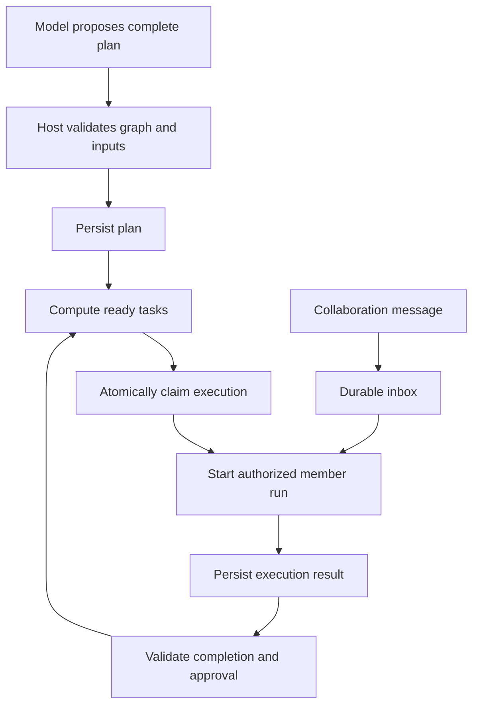

# Agent Team 程序化调度、执行校验与消息协作设计

[English](agent-team-controlled-scheduling.md) | 中文

## 目录

- [概述](#section-1)
- [现有能力与相关设计](#section-2)
- [职责与执行流程](#section-3)
- [计划、依赖与完成条件](#section-4)
- [统一启动校验与原子领取](#section-5)
- [消息、任务分配与停止入口](#section-6)
- [成员状态下的投递策略](#section-7)
- [执行许可与引擎防绕过](#section-8)
- [自动调度、恢复与观测](#section-9)
- [实施、兼容性与验收](#section-10)

<a id="section-1"></a>

## 概述

状态：已实现，路径与审批校验有明确范围。日期：2026-10-07。模型提出任务、依赖、执行者和协作消息；Host 根据持久状态校验计划、计算可执行性、领取执行权、启动成员并从持久状态恢复中断操作。[功能清单](../../../worktree-feature-list.md)记录验证结果及限制。

实现会阻止未 ready 的任务启动、消息绕过调度和重复创建工作流。已分配的就绪任务会在依赖与用户审批满足后自动调度。执行派发前会检查声明输入路径在任务工作区中存在；完成前会检查声明成果存在于工作区和写入范围中。本文记录当前行为及限制。

<a id="section-2"></a>

## 现有能力与相关设计

当前 [task-view.ts](../../../packages/experimental/agent-team/src/task-view.ts) 根据前置任务 completed 计算 ready；[task-board.ts](../../../packages/experimental/agent-team/src/task-board.ts) 在 claim 等操作检查依赖；[task-graph.ts](../../../packages/experimental/agent-team/src/task-graph.ts) 验证图；[mailbox.ts](../../../packages/experimental/agent-team/src/mailbox.ts) 已有消息持久投递及去重机制。因此本期是在已有机制上补齐统一控制，不重新创建另一套任务板和消息存储。

[即时调度提案](agent-team-workflow-dispatch.zh.md)提出依赖检查、领取、唤醒组合能力。该文的强制中断后投递、按顺序逐项创建计划及完成条件不能视作本方案的安全保证：新方案要求完整图原子提交、启动权持久领取、唤醒与执行授权分离。实施时先审计该提案相关代码，再按本文更新；UI 展示沿用[任务流程图设计](team-panel-flow.zh.md)。

服务层派发、工具派发、工作流创建、审批、引擎执行回调和 Harness 原生工具现在共用持久任务状态校验；`ready` 投影只供展示，领取时仍在事务中复核。

<a id="section-3"></a>

## 职责与执行流程

| 环节 | 模型职责 | Host 职责 |
|---|---|---|
| 计划 | 拆解任务、声明依赖、输入、成果及执行者 | 验证 ID、引用、环、输入引用与依赖的一致性，原子保存全部任务 |
| 调度 | 请求执行或提出优先级建议 | 计算 ready、检查审批、并发和写入范围冲突，领取执行权 |
| 启动 | 提供任务要求及明确模型选择 | 校验实际引擎与配置，创建执行记录及成员运行实例 |
| 结束 | 提交结果与说明 | 接收实际执行结果，验证完成条件，更新权威状态 |
| 协作 | 发送补充、询问、讨论 | 持久投递、去重、有序消费和授权控制 |
| 恢复 | 可解释问题并提出修复 | 核对进程／会话、撤销过期授权、阻止不确定的自动重启 |



消息进入 inbox 不意味着启动箭头已经获得授权。普通讨论和任务执行的授权不同，执行回合始终经过 ready 与领取检查。

<a id="section-4"></a>

## 计划、依赖与完成条件

模型一次提交全部已知任务，包含等待中的后续任务。Host 校验任务 ID／阶段名唯一、前置存在、无自依赖、无环、执行者有效、输入引用明确；失败时整批拒绝，不保存半个计划。修改依赖使用 expectedRevision，并在事务里与领取检查协调；已领取或正在执行任务不允许修改依赖。

现有默认前置 completed 语义先保留。本方案增加显式完成门槛：execution-success 表示实际执行成功且配置的结果校验通过；user-accepted 表示还必须有用户验收。用户要求审批时持久记录审批门槛，不能只靠 Lead 提示词记忆。失败、停止、进程退出、删除前置及模型文字“完成”均不自动满足依赖。

每个任务写明输入引用、预期成果及完成条件。引用另一个任务的成果必须声明对应依赖；启动时检查输入实际可用，结束时检查可机械验证的产物／测试结果。自由文本业务依赖仍可能被模型遗漏，程序只能检查已声明和可观察的条件，不能保证理解全部业务逻辑。无法机械验证的条件保留人工或模型审核门槛。

取消或失败的前置使后继显示阻塞及原因，不通过删除依赖自动继续。重开前置会使原验收失效并重新计算后继；活动后继存在时先停止或结束再修改前置状态，已交付结果保留历史。

<a id="section-5"></a>

## 统一启动校验与原子领取

所有模型工具、界面操作、自动调度、消息唤醒、重试和恢复经过同一个 Host 启动入口。托管模式的执行成员必须绑定 taskId；省略 ID 时先创建独立任务，再执行检查，不能直接使用旧的通用 spawn 绕过。允许创建不启动进程的成员身份，等待依赖时展示该身份和任务。

启动前同时检查：任务待执行、全部依赖满足、审批通过、无取消请求、没有有效领取或活动执行、执行者与模型配置有效、输入可用、并发及资源限制满足。ready 投影仅用于展示，真正领取时在最新修订上再次校验，避免“先读取 ready、后依赖变化”的竞态。

Host 原子持久保存 executionId、taskId、memberId、requestId、任务／计划修订、领取状态、owner、fencingGeneration 和执行许可，再启动进程。requestId 去重，相同请求返回原执行，不同参数复用同一 requestId 拒绝。领取竞争只能成功一次；资源名额也在统一领取中分配，不靠多个成员各自读取空闲数。

数据库提交不能和进程创建做成同一个事务。执行状态区分 reserved、starting、running、ended、failed、stopped、startup-unconfirmed。明确未创建进程的失败可释放领取；启动中崩溃不能直接释放并重试，必须先核对既有会话和进程，未知时进入需要处理。每次尝试的 Session 身份与执行记录必须可关联。

并发上限、领取有效期、重试次数和超时均使用经 schema 校验的 Config。租约失效不单独授权新进程：须确认旧执行停止并增加 fencingGeneration，使旧实例的状态写入和工具授权失效。

<a id="section-6"></a>

## 消息、任务分配与停止入口

| 拟议入口 | 用途 | Host 处理 |
|---|---|---|
| sendMessage | 补充信息、询问、讨论 | 校验发送者与成员身份，持久入队，不授予任务执行权 |
| assignTask | 分配或请求执行工作 | 绑定 taskId，检查 ready，通过统一调度入口 |
| requestStop | 停止本次执行 | 直接执行进程／引擎停止机制，持久记录结果，不等待模型阅读消息 |

现有工具名可保留，但其调用必须归入上述语义。消息的 purpose（context、question、discussion）仅用于展示与投递策略，不能作为可信安全判定；不通过识别文字“开始执行”决定是否授权。

每条消息持久保存 messageId、requestId、Team、发送者、收件成员 ID、可选 taskId／executionId、purpose、正文和时间。以稳定成员 ID 寻址，不因同名新成员而误投；消息必须在调用者权限范围内，不能跨 Team 任意读取或发送。需要执行的工作使用 assignTask，不以普通消息隐式创建执行。

队列记录 accepted（已保存）、delivered（目标会话已持久记录）、consumed（实际输入已领取）和关联 reply；已有 mailbox 确认字段能复用则复用。delivered 不等于 consumed，consumed 不等于模型理解或回复；外部引擎无消费确认时只显示已投递。回复通过 replyTo 关联消息，不把任何后续消息自动当成回复。

采用持久消息 ID 加消费端去重，不承诺跨进程 exactly-once；目标已经写入但发送侧尚未确认的崩溃由恢复核对，不能重复生成输入。每收件人维持可重建的投递次序，任务关联消息只在对应任务／执行范围内消费。

<a id="section-7"></a>

## 成员状态下的投递策略

| 成员状态 | 投递与唤醒策略 |
|---|---|
| 执行中 | 进入 inbox，在引擎支持的安全输入时机消费；不启动并行 turn，不为普通消息强制中断 |
| 任务未 ready | 只持久保存，不启动进程；任务就绪且领取后，把任务要求与相关未消费消息一起提供 |
| 空闲、进程仍在 | 可请求只读沟通回合；执行工具需要单独的有效任务许可 |
| 已结束／进程退出 | 保存并显示等待恢复；明确恢复请求也必须再次检查任务，已完成任务不因消息自动重开 |
| 失败／启动待确认 | 保留消息及原因，恢复核对前不启动另一个实例 |

```text
Task B depends on Task A
Lead -> B: add a performance comparison to the report
Host: save the message; B remains blocked
Task A satisfies its completion gate
Scheduler: claim and start B
Host: provide task instructions and queued context to B
```

首版若不能提供严格只读的外部引擎沟通回合，则空闲成员消息只排队，用户界面说明等待下一次授权执行；不能以“只是聊天”为由启动拥有完全工具权限的 Claude／Codex 实例。强制中断是显式控制操作，须结束／停止确认当前执行后重新领取，不是 sendMessage 的默认选项。

<a id="section-8"></a>

## 执行许可与引擎防绕过

执行许可由 Host 创建，绑定 Team、taskId、executionId、memberId、计划修订、fencingGeneration、允许的工具／写入范围和有效期。模型不能创建、修改或续期许可；提示词中的 ID 不是许可。许可不增加全局权限，实际权限是应用／用户授权与任务许可的交集。

原生工具调用在 Host 校验许可，结束、取消、过期或失主后拒绝后续执行请求。对于 Claude／Codex，只有在引擎启动权限、工具审批回调或沙箱能覆盖实际 shell／文件操作时，才能声称同等控制。不能仅校验 Harness MCP 工具而忽略引擎自带工具，也不能把本地任务 token 写进 prompt 当作防护。

未就绪任务和普通消息不会启动外部进程。任务许可绑定执行代次；完成、释放、改派或回合结束后撤销当前代次。Harness `write`/`edit` 及 Claude/Codex 任务文件权限会执行声明的文件范围；其他原生工作工具要求用户一次性批准。该实现无法约束获批命令的所有副作用或外部资源。

消息内容作为数据进入转录；来源文本不能扩大权限。任务状态和完成门槛由 Host 维护，成员提出完成候选，只有实际执行结算和所需审核通过后才满足依赖。

<a id="section-9"></a>

## 自动调度、恢复与观测

调度器在计划提交、依赖完成、审批通过、任务变更、成员进入运行状态及根会话恢复后重新计算 ready，并以可配置间隔扫描所有活动 Team 根，补偿漏掉的生命周期通知。它只启动持久保存了执行者的任务，按任务创建顺序扫描；同一任务只能领取一次。成员由已保存分配或模型明确选择产生，Host 不自行猜测厂商和模型别名。当前没有并发资源配额或失败任务自动重试。

重试只创建新执行尝试，保留旧记录；默认不自动重试未经分类的失败。重试策略声明可重试错误、次数、退避和是否需要用户确认，依赖未满足不计为运行失败。调度器异常不清空计划，不将任务标完成。Team 取消先阻止新领取、撤销许可并请求停止，停止失败显示待处理。

恢复加载任务、执行、许可和消息账本，核对 owner 及实际会话／进程。旧 lease 失效不代表进程消失；失主或不确定实例标为待核对，未确认前禁止重复启动。恢复后重新计算 ready 和资源占用，不从成员显示状态推断任务已完成。

界面展示任务 ready／阻塞原因、依赖门槛、领取／启动中、当前成员、执行起止时间、重试次数、排队消息数和最后投递状态。原有依赖流程图使用 Host 投影；模型解释只作为附加说明。审计记录计划修订、领取拒绝、执行启动／结束、审批、许可撤销和消息关联；模型可见内容仍须可由 Session 日志重建。

<a id="section-10"></a>

## 实施、兼容性与验收

先审计 agent-team、tool-agent-team、subagent 以及 Claude／Codex 引擎启动、消息输入与恢复入口；复用 TaskBoard、Mailbox 和现有图检查。新持久字段采用项目相邻迁移及类型确认规则，旧 Session 日志不改写。托管启动、消息不再自动唤醒及审批门槛会改变工具可感知行为，实现时同步所有消费者、双语 README、升级指南、模型快照和功能清单。

自动调度适用于显式分配的任务，并在任务创建、依赖变更、审批、成员状态变化和根会话恢复后运行。持久化的 `startup-unconfirmed` 会阻止不确定派发或失主任务自动重试。当前没有周期性核对、资源配额、命令副作用隔离或失败任务自动重试。输入／成果校验涵盖工作区相对路径的存在性、工作区包含关系、符号链接和输出写入范围；不会运行任意验收命令，也无法推断未声明的业务条件。

| 验收场景 | 必须满足的结果 |
|---|---|
| 提前 assignTask／spawn／重试 | 拒绝，返回 blockedBy，不创建进程 |
| 未 ready 收到“立即执行”的普通消息 | 消息保存，进程未启动、工具不执行 |
| 两个调用者同时启动同任务 | 唯一领取和执行；重复请求得到原结果 |
| 检查 ready 后依赖或审批变化 | 最终领取复核拒绝过期条件 |
| 领取后、进程创建后、确认写入前崩溃 | 核对实际身份，不自动生成第二实例 |
| queued／running 成员接收消息 | 持久顺序、无并行 turn、重复投递不重复输入 |
| 外部引擎无消费确认 | 仅显示已投递，不伪造已读 |
| 旧 lease 到期但进程存活 | 不盲目重启，旧代许可撤销及工具路径验证 |
| 删除、取消、失败或待审核前置 | 后继保持阻塞，不等同成功 |
| 有向环、缺引用、输入未准备 | 原子拒绝计划或阻止启动，保留修复信息 |
| 权限不足、跨 Team 消息、成员替换 | 明确拒绝，不扩大授权或误投 |
| native／Claude／Codex 启动和工具执行 | 实际执行路径遵循已声明防护范围 |

覆盖并发、队列、生命周期、恢复、模型可见拒绝结果与 keyless 快照；真实引擎验证不由 mock 替代。使用[日常构建](../../cookbook/local-builds.zh.md)协调 Web／Desktop／依赖及插件产物，构建通过与功能验收分别记录。当前实现与已验证范围记录在[功能清单](../../../worktree-feature-list.md)。
