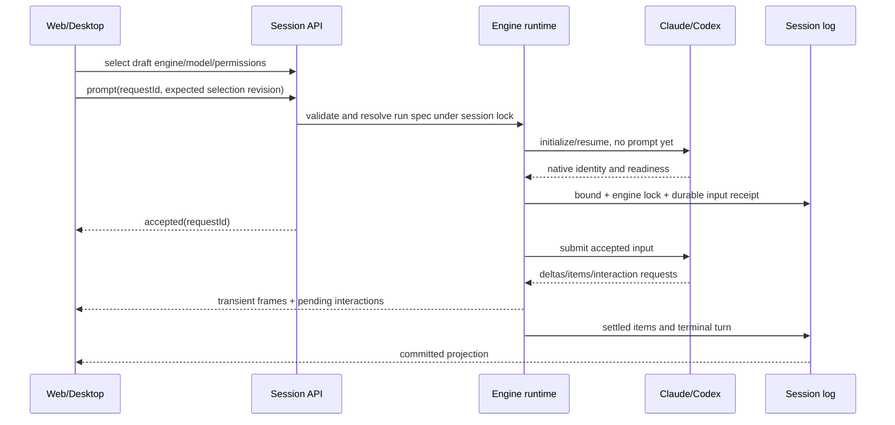

# Main engine end-to-end implementation plan

English | [中文](end-to-end-plan.zh.md)

Status: implementation in the checkout; real-provider acceptance pending. Owner: main engine implementer. Reviewed: 2026-09-30. Review due: 2026-10-30. Owning package documentation describes the implemented execution path.

## Summary

Complete the path from engine selection to an SDK-backed main conversation: parameter admission, durable input, incremental output, human interaction, interruption, and restart recovery. This plan applies to the current working tree and records source findings rather than claiming runtime verification.

This plan refines the [previous task packets](implementation-plan.md) and [detailed design](detailed-design.md). It replaces their creation-time engine lock with the requested first-message lock. Native sessions with existing messages remain native; empty sessions have no committed engine.

## Contents

- [Baseline source findings](#source-findings)
- [Execution and parameters](#execution-and-parameters)
- [Streaming and records](#streaming-and-records)
- [Authorization and cancellation](#authorization-and-cancellation)
- [Recovery](#recovery)
- [Implementation packets](#implementation-packets)
- [Acceptance and handoff](#acceptance-and-handoff)

## Baseline source findings

These are inspected code paths, not hypothetical failure modes. Each finding has an implementation owner below.

| Owner | Current behavior | Required change |
|---|---|---|
| `api/session-controller/src/commands.ts` | `selectEngine()` appends a record but does not replace the live Agent. | Resolve execution ownership when admitting the first prompt. |
| `api/session-controller/src/agent.ts` | Factories receive the global default provider/model before session selections are applied; empty cold sessions are resumed as native. | Resolve the selected engine and current session options together before starting external execution. |
| Both `subagent-*/src/engine.ts` main factories | Create sessions directly, do not invoke `options.setup`, and use the caller context as the Agent context. | Reuse scoped publication, persistence, setup and rollback lifecycle. |
| Both main Agent drivers | `followup()` uses a private queue; `send()` also writes an inbox; consumed input is not removed consistently. Active cancellation controllers are no longer in the queue; status changes do not emit `agent/status`. | One durable inbox, tracked active turn, scoped status publication and acknowledged cancellation. |
| Claude `main-adapter.ts` | Collects complete text only; declines tool approval; captures an SDK session id only in memory; startup returns before SDK readiness. | Partial output, readiness handshake, interaction bridge and durable native identity. |
| Codex `main-adapter.ts` and `wire.ts` | Reuses the subagent wire, creates `ephemeral: true` threads, collects final text, declines interactive requests. | Separate persistent main-thread policy from one-shot subagent policy; forward item and delta events. |
| `core/session/src/types.ts` and conversation consumers | Three coarse engine execution records exist; no production consumer of `engine/item-settled` was found outside the engine drivers. | Typed execution records, common read projection and client renderers. |
| Both main factories | `resume()` rejects explicitly; capabilities advertise no resume, approval or user input. | Implement and verify those paths before enabling capabilities. |

## Execution and parameters

DSH owns the application, accepted inputs, transcript and controls. The selected engine owns model requests and native tool execution. Main-chat messages never use the subagent delegation tool.

An empty session is an application Session plus draft selection, not a paid or running external conversation. Keep any temporary native handle replaceable before admission. The shared runtime must adopt the existing Session writer; an external factory must not create a second Session with the same id.

Serialize select-engine, select-model, permission changes, prompt admission and execution attachment per Session. Persist a draft selection revision or use an atomic prompt selection payload; choose and document one API in packet E1. Reject stale revisions before input acceptance. Read-only opening must not spawn a provider.

Lock the engine when the first user input is durably accepted, including queued user input. Failed configuration/readiness before acceptance leaves the session empty and switchable. After acceptance, runtime failures preserve engine ownership. Historical sessions with user input and no engine selection resolve explicitly to native.

Use a proposed `ResolvedEngineRunSpec` produced by an explicit resolver. Separate durable non-secret session/turn facts from private credentials and process options. Do not reuse native LLM request normalization for external-engine models without checking endpoint compatibility.

| Parameter | Source and lifetime | Claude mapping | Codex mapping |
|---|---|---|---|
| `engineId` | Draft until first admission; fixed afterward | `claude` factory | `codex` factory |
| `cwd` | Validated Workspace path; fixed session identity | `Options.cwd` and child cwd | thread cwd and child cwd |
| provider, model, effort | Session selection captured for each admitted turn; idle-only changes initially | `Options.model`, supported effort; query control only if pinned SDK permits | `model_provider` config, thread/turn model and effort supported by pinned schema |
| endpoint URL | Explicit provider endpoint; never guess another provider | `ANTHROPIC_BASE_URL` | private provider table `base_url`; require Responses compatibility |
| credential | Resolve shared credential reference at bind/rebind; server only | documented token/key environment for selected provider | private `DSH_CODEX_API_KEY` and provider `env_key` |
| permission preset, sandbox | Session effective policy; preserve host policy ceilings | explicitly mapped `permissionMode` plus DSH approval callback | explicit `approvalPolicy`, reviewer and sandbox parameters |
| input, request id | Accepted content and stable deduplication id | SDK user-message id where supported; structured text content | `turn/start.input`; retain native turn association |
| native identity, storage | Durable binding; host and workspace checked on resume | `resume` with persisted session id and controlled storage | non-ephemeral thread id, stable `CODEX_HOME`, `thread/resume` |

Unsupported effort, attachments, steering, injection, fork or preset contributions reject before queue mutation. Do not silently omit a user choice. Model/provider changes requiring a new process must resume the same native identity or fail explicitly. Policy and endpoint changes cannot redirect an active turn.

Credentials must never enter argv, public run specs, RPC responses or Session records. Reject deployment environment collisions with resolver-owned routing fields unless explicitly represented in the resolved spec. The current config-env override must not silently change a logged provider.

## Streaming and records

Define a common engine output vocabulary with validated payloads and branded native session/turn/item ids. Persist accepted user content, input intent, binding, item settlements and terminal outcome. Extend event definitions through the owning package and update every reader; do not keep `contentRef: text` as the only record of user content.

Keep transient delta frames separate from committed events, following the existing assistant-stream carrier pattern. Correlate frames with engine binding epoch, turn id, item id, block index and revision. The settled item replaces transient content once; it never appends the full text a second time.

Claude enables `includePartialMessages`, processes partial text/tool input and complete assistant blocks, and captures initialization and result identities. Correlate shared message ids and block indices so partial and complete SDK output do not duplicate text. Codex forwards item start/completion, assistant deltas, command progress, file changes, usage and turn terminal notifications from the pinned wire.

The neutral projection feeds conversation nodes, tool/activity cards, unread/running state and history export. Native tools remain native tools; external tool events are observational and must never call the DSH tool executor again. Render external-engine history even when its execution plugin is removed.

Reconnect from the durable cursor and rehydrate active transient snapshots when available. A renderer discards stale epochs and replaces settled items by revision. Bound buffering, coalescing intervals and frame sizes are validated deployment config; slow clients must not stall native execution.

## Authorization and cancellation

Model-provider authentication, DSH connection authentication, execution permission policy and per-operation approval are separate checks. A selected engine must pass all applicable checks; being listed in the menu grants none of them.

Reuse `user-approval`, `user-questions` and their UI carriers. Maintain a pending interaction map keyed by Session, binding epoch, native thread/session, turn, item and SDK request id. A native protocol request id is not a DSH approval id.

Claude maps `canUseTool` allow/deny replies, question tools and supported elicitation callbacks to those services. Codex maps command/file/permission approval and user-input requests to pinned response unions. Present exact requested operations and offered choices; add typed fields when the existing approval payload cannot describe them. Never synthesize broader permission than the SDK requested.

Human-review mode routes to the DSH answerer rather than an automatic reviewer. Build and verify a policy matrix for each DSH preset, including read-only, workspace writes and explicitly authorized bypass. Engine-native confinement and DSH process confinement must compose without widening the host policy.

Stop transitions to stopping, aborts the active-turn controller, withdraws interactions and requests SDK interruption. Preserve or discard queued inbox entries according to `CancelOptions`; cancelled queued entries never submit. Mark the turn cancelled only after native terminal confirmation or controlled process termination.

Claude awaits interrupt/result handling without aborting the whole query for an ordinary stop. Codex handles stop before `turn/start` acknowledgement and issues `turn/interrupt` once the turn id becomes known. A configurable timeout terminates an unresponsive managed child, waits for exit and marks the binding for reconciliation before further work.

Late approval replies, stale SDK events and duplicate stops are idempotent or rejected. Browser disconnection detaches observation without implicitly stopping execution. Desktop shutdown, archive and plugin disposal cancel owned work and await quiescence; they do not kill other sessions.

## Recovery

Distinguish browser reconnect, follow-up after stopping, provider process restart and full application restart. Reconnect reads existing execution; it does not call native resume while a live owner exists. Follow-up reuses the surviving native identity. Cold execution attachment loads the saved engine and binding before choosing a factory.

Claude resumes the captured SDK session under controlled persistent storage. Codex must create non-ephemeral main threads and resume the persisted thread under a stable configured home. Keep one-shot subagent threads ephemeral. Missing storage, unsupported versions or changed workspace/host produce actionable errors, never a new native conversation or native-engine fallback.

Implement an outbox state machine: accepted input → dispatch intent → observed native acceptance → settled. Persist stable request/input ids and correlate provider evidence. An acknowledgement lost after native submission is uncertain, not unsent. Never automatically replay uncertain tool-producing input; reconcile from native history where supported or require an explicit recovery choice.

Recover terminal items by stable native identity and revision, settle interrupted open turns once, and expire interactions tied to dead processes. An already recorded approval cannot authorize a newly issued native request. Preserve canonical committed Session generations and apply declared persistence-change acknowledgements to every changed type.

## Implementation packets

Implement packets in dependency order. Each packet includes its changed consumers, owning documentation and focused evidence; an unchecked capability remains disabled. Paths below are repository-relative and identify edit scope, not permission to discard existing work.

| Packet | Dependencies and files | Deliverable and exit condition |
|---|---|---|
| E0: pinned protocol evidence | Current adapters, Claude SDK 0.3.263 declarations, Codex 0.153.4 protocol | Record readiness, ids, partial events, approvals, interruption, durable storage and resume fixtures. Keep app-server for Codex unless an SDK satisfies all interactive requirements; document that decision. |
| E1: atomic selection and admission | E0; `api/session-controller`, `client/ui-model-selection`, `client/ui-chat`, `core/agent` | Draft revision/atomic prompt API, engine-aware model validation and first-input lock; selected engine really executes after any number of empty-session switches. |
| E2: shared execution lifecycle | E1; `core/agent`, `core/agent-loop`, session persistence, both engine factories | Scoped create/adopt/resume, setup commit, publication rollback, durable inbox, active controllers, status events and ordered disposal. Preserve native behavior. |
| E3: records and presentation | E1/E2; `core/session`, session-format owners, `api/session-controller`, `client/ui-conversation` and activity renderers | Typed bindings/input/item/outcome, neutral projection, transient stream channel, replay and deduplication; update all readers and persistence acknowledgements. |
| E4: Claude execution | E0/E2/E3; Claude `engine.ts`, `main-adapter.ts`, `endpoint.ts`, process owner | Resolved run spec reaches query, readiness is awaited, two turns share context, partial text/tools/usage settle once and errors propagate. |
| E5: Codex execution | E0/E2/E3; Codex `engine.ts`, `main-adapter.ts`, `wire.ts`, `endpoint.ts` | Persistent main-thread policy, explicit turn association, per-turn state reset, deltas and activities, Responses routing and model/effort mapping. Existing subagent behavior stays intact. |
| E6: interaction and stop | E4/E5; approval/questions services, `client/ui-approval`, session controls, both adapters | Exact permission mapping, owned interaction replies, stop during start/stream/tool/approval, timeout termination and stale-reply rejection. Enable approval/userInput only after evidence. |
| E7: native recovery | E4/E5/E6; session query/persistence, both factories, engine projection | Stable storage and native ids, read-only cold history, explicit execution attachment, uncertain-delivery reconciliation and continuation after stop/restart. Enable resume only after evidence. |
| E8: release integration | E1–E7; web-app/profile bundles, Desktop resolver, TS/Python SDK projections and snapshots | Web/Desktop same flow, optional plugin installation, localized controls, shared settings, built smokes and SDK outputs; update accepted architecture and package docs. |

For lightweight models, split E2, E3, E6 and E7 into interface-first and consumer/provider subpackets. Finish and review a shared interface before assigning adapter work. Never implement both new lifecycle and both SDK bridges in one unbounded task.

## Acceptance and handoff

The following is planned evidence, not tests already run. No paid SDK requests or behavior tests were executed while writing this plan. The implementation stage must include focused unit/protocol tests, keyless session snapshots and separately authorized real-provider checks.

| Scenario | Required observation |
|---|---|
| Empty selection cycling and reload | All three options remain clickable; no prompt/process side effects; first prompt uses the last selected engine. |
| Concurrent selection and duplicate send | Revision conflict or deterministic ordering; one durable receipt and one native submission for an acknowledged request id. |
| URL/key/model/effort/cwd/policy | Scripted adapter observes exact selected values; wire is redacted; invalid combinations reject before receipt. |
| Two or more turns | Prior context is retained; each turn has its own output, terminal result and status; no stale previous answer. |
| Partial output and reload | Text appears before completion; tools show progress; final/replayed output has no duplicates; missing plugin still permits reading. |
| Approve, reject, question and browser reconnect | Only the current owning SDK request receives one reply; rejection prevents the requested operation. |
| Stop before ready, during streaming, tool or approval | Active native work stops or managed exit is confirmed; queues follow policy; stale approvals cannot run; next input can continue. |
| Restart and uncertain dispatch | Same native identity and durable input; no automatic duplicate side effect; missing history gives an explicit recovery error. |
| Native sessions and plugin unload | Historical native sessions stay native; existing native lifecycle remains valid; unloading one engine does not stop another. |
| Web/Desktop and both SDKs | Equivalent transcript/control outcomes and updated TypeScript/Python expected outputs. |

Each implementation handoff names one packet/subpacket, allowed files, settled interfaces, fixtures, commands actually run, remaining gaps and the next dependency. A reviewer checks the matrix for both engines; successful compilation alone does not demonstrate recovery or permission correctness.

## Sources and unresolved version facts

Official guidance confirms Claude partial-message output, native session resume and callback-based approvals. Codex documents an interactive app-server and a distinct TypeScript SDK. The linked pages describe current upstream behavior; E0 must verify every chosen field against the installed versions before implementation.

- [Claude streaming output](https://code.claude.com/docs/en/agent-sdk/streaming-output).
- [Claude permissions](https://code.claude.com/docs/en/agent-sdk/permissions) and [sessions](https://code.claude.com/docs/en/agent-sdk/sessions).
- [Codex app-server](https://learn.chatgpt.com/docs/app-server) and [TypeScript SDK source](https://github.com/openai/codex/blob/main/sdk/typescript/README.md).

## Dev Note

No shipped behavior is claimed by this document. Exact native acceptance evidence, permission unions, resumed-turn reconciliation and storage hooks remain E0 implementation prerequisites.

## Execution projection

Managed external execution reuses the existing assistant stream and user/assistant message projection. A single observation step represents each complete native turn, without a DSH model request or DSH tool execution. Native activity payloads remain within the existing `engine/item-settled` event and are validated by their consumer. Uncertain delivery is explicitly acknowledged with `/engine-recover continue` after inspection of native history. Protocol evidence and compilation do not establish real-provider acceptance; credentialed integration and behavior snapshots remain acceptance work.

Supported user input covers Claude AskUserQuestion, validated primitive MCP elicitation forms and HTTP(S) URL confirmation, plus Codex non-secret requestUserInput. Unknown dialogs and secret input are declined. URL confirmation does not automate browser authentication. Claude tool progress, reasoning fallback and idle CLI recovery are implemented. Focused regression tests pass (15 cases), and the real SDK/CLI loopback tests pass (4 cases: multi-turn resume, permission allow/deny and interruption). The shipped-profile Loader test passes against the configured DeepSeek Claude-compatible endpoint: two turns retain context, persisted events settle once, and a third turn resumes the same native identity. Recorded-session acceptance and the remaining browser interaction scenarios remain pending.
