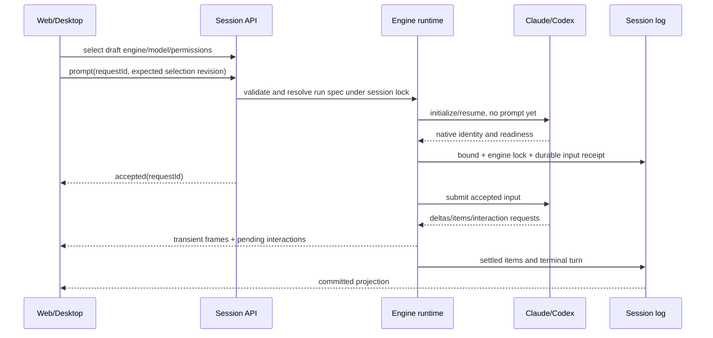

# 主会话引擎端到端实施计划

[English](end-to-end-plan.md) | 中文

状态：实现已写入工作区，真实提供者验收待进行。负责人：主引擎实现者。审阅日期：2026-09-30。下次审阅：2026-10-30。所属包文档描述已实现的执行路径。

## 概要

打通引擎选择到 SDK 主会话执行的完整链路：参数准入、输入持久化、增量输出、人工交互、中止及重启恢复。本计划针对当前工作树，源码调研结论不等于运行验证。

本计划细化[原任务包](implementation-plan.zh.md)和[详细设计](detailed-design.zh.md)，将其中“创建时锁定引擎”修订为用户要求的“首条消息准入时锁定”。已有消息且没有引擎标识的历史会话保持原生；空会话没有已提交的引擎。

## 目录

- [实现前的源码缺口](#source-findings)
- [执行流程与参数](#execution-and-parameters)
- [流式传输与记录](#streaming-and-records)
- [授权与中止](#authorization-and-cancellation)
- [恢复](#recovery)
- [实施任务包](#implementation-packets)
- [验收与交接](#acceptance-and-handoff)

## 实现前的源码缺口

以下是已检查源码中的具体缺口，各项都有后续实施负责人。

| 所属代码 | 当前行为 | 必须修改 |
|---|---|---|
| `api/session-controller/src/commands.ts` | `selectEngine()` 只追加事件，不替换已有 Agent。 | 在首条消息准入时确定执行所有者。 |
| `api/session-controller/src/agent.ts` | 工厂先收到全局默认 provider/model；空会话冷打开按原生恢复。 | 启动外部执行前联合解析所选引擎与会话参数。 |
| 两个 `subagent-*/src/engine.ts` 主引擎工厂 | 直接创建 Session，没有调用 `options.setup`，使用调用方 Context 作为 Agent Context。 | 复用作用域发布、持久化、setup 与回滚生命周期。 |
| 两个主 Agent 驱动器 | `followup()` 使用私有队列；`send()` 又写 inbox；消费后没有统一移除。活动轮的取消控制器已出队；状态变化不发 `agent/status`。 | 使用单一持久化 inbox、活动轮追踪、作用域状态发布与确认后的取消。 |
| Claude `main-adapter.ts` | 只收完整文本；拒绝工具审批；SDK 会话 ID 仅存在内存；就绪前已返回启动成功。 | 增量输出、就绪握手、交互桥及原生标识持久化。 |
| Codex `main-adapter.ts` 与 `wire.ts` | 复用子代理 wire，创建 `ephemeral: true` 线程，只收最终文本，拒绝交互请求。 | 分离持久化主线程与一次性子代理策略，转发 item 与 delta。 |
| `core/session/src/types.ts` 与对话消费者 | 已有三种粗粒度引擎执行事件；主驱动器之外未找到 `engine/item-settled` 的生产消费方。 | 定义执行事件、公共读取投影及前端渲染器。 |
| 两个主引擎工厂 | `resume()` 明确拒绝；能力声明不支持恢复、审批与用户输入。 | 完成实现并验证后再开启能力。 |

## 执行流程与参数

DSH 负责应用、已接受输入、对话记录与控制；所选引擎负责模型请求及原生工具执行。主会话消息不经过子代理委派工具。

空会话是应用 Session 加草稿选择，不需要付费请求或运行中的外部会话。准入前允许替换临时原生句柄。共享运行时必须接管已有 Session 写入者；外部工厂不能以同一 ID 再创建 Session。

按 Session 串行处理引擎选择、模型选择、权限变化、消息准入及执行绑定。E1 确定一种 API：持久化草稿选择修订号，或在 prompt 中原子提交选择参数；过期修订在消息接受前拒绝。只读打开不能启动引擎。

首条用户输入持久化接受时锁定引擎，包括已入队的用户输入。接受前配置或就绪失败，会话仍为空且允许切换；接受后的执行失败保留引擎所有权。已有用户输入但无引擎记录的历史会话明确解析为原生。

通过显式解析器生成拟议的 `ResolvedEngineRunSpec`。区分可持久化的非秘密会话/轮参数与私有凭证、进程参数。外部模型的解析不能直接套用原生 LLM 请求归一化，必须验证 endpoint 兼容性。

| 参数 | 来源与作用期 | Claude 映射 | Codex 映射 |
|---|---|---|---|
| `engineId` | 首次准入前为草稿，之后固定 | `claude` 工厂 | `codex` 工厂 |
| `cwd` | 校验后的 Workspace 路径，会话固定标识 | `Options.cwd` 与子进程 cwd | thread cwd 与子进程 cwd |
| provider、model、effort | 按轮准入捕获会话选择，首版只允许空闲时变化 | `Options.model`、支持的 effort；query 控制以固定 SDK 支持为准 | `model_provider` 配置及固定协议支持的 thread/turn model、effort |
| endpoint URL | 显式 provider endpoint，不猜测另一厂商 | `ANTHROPIC_BASE_URL` | 私有 provider 表 `base_url`；要求 Responses 兼容 |
| credential | 绑定/重绑定时解析共享凭证引用，仅服务端可见 | 所选厂商支持的 token/key 环境变量 | 私有 `DSH_CODEX_API_KEY` 与 provider `env_key` |
| 权限预设、sandbox | 会话有效策略，遵守宿主策略上限 | 显式映射 `permissionMode` 加 DSH 审批回调 | 显式 `approvalPolicy`、reviewer 与 sandbox 参数 |
| 输入、request ID | 接受内容与稳定去重 ID | 支持时使用 SDK 用户消息 ID；结构化文本内容 | `turn/start.input`，保留原生 turn 关联 |
| 原生标识、存储 | 持久化绑定；恢复时校验主机与工作区 | 持久化会话 ID、受控存储及 `resume` | 非临时 thread ID、稳定 `CODEX_HOME` 与 `thread/resume` |

不支持的 effort、附件、steering、注入、fork 或 preset 贡献在修改队列前拒绝，不能静默忽略用户选择。需要新进程的模型/provider 变化必须恢复同一原生标识，或明确失败；权限及 endpoint 变化不能改写活动轮。

凭证不能进入 argv、公共运行参数、RPC 返回或 Session 日志。部署环境若覆盖解析器拥有的路由字段，必须在解析结果中明确体现，否则拒绝。现有 config-env 覆盖不能静默改变已记录 provider。

## 流式传输与记录

定义具有校验载荷及品牌化原生 session/turn/item ID 的公共引擎输出类型。持久化已接受用户内容、投递意图、绑定、item 结算与最终结果。由所属包扩展事件定义并更新全部读取方，不能只用 `contentRef: text` 代替用户内容。

按照已有 assistant-stream 传输模式分离临时 delta 帧与持久化事件。使用引擎绑定 epoch、turn ID、item ID、block index 及 revision 关联帧。结算 item 一次性替换临时内容，不能再追加一次完整文本。

Claude 开启 `includePartialMessages`，处理部分文本/工具输入及完整 assistant block，并捕获初始化与结果标识。按 message ID 和 block index 去重部分与完整消息。Codex 从固定 wire 转发 item 开始/完成、assistant delta、命令进度、文件变化、用量及 turn 结束通知。

公共投影服务对话节点、工具/活动卡片、未读/运行状态与历史导出。外部工具事件只用于观察，不能再调用 DSH 工具执行器。执行插件被移除后，公共读取方仍能展示外部历史。

重连从持久化游标继续，存在活动临时快照时重新加载。渲染器丢弃旧 epoch，按 revision 替换结算 item。缓冲上限、合并间隔和帧大小通过部署配置校验；慢客户端不能阻塞原生执行。

## 授权与中止

模型厂商认证、DSH 连接认证、执行权限策略与单次操作审批分别校验。所选引擎必须通过适用的全部校验，下拉列表可见不等于获得授权。

复用 `user-approval`、`user-questions` 及其 UI 传输。待处理交互表关联 Session、绑定 epoch、原生 thread/session、turn、item 与 SDK request ID。原生协议 request ID 不等于 DSH approval ID。

Claude 将 `canUseTool` 允许/拒绝、提问工具及支持的 elicitation 回调接入这些服务。Codex 将命令/文件/权限审批及用户输入请求映射到固定版本响应联合类型。展示实际请求的操作与选项；现有审批载荷不足时增加类型字段。不能生成比 SDK 请求更宽的授权。

人工审批模式转到 DSH 回答者，不能交给自动 reviewer。为各 DSH 预设建立并验证策略映射表，包括只读、工作区写入及明确授权的 bypass。引擎原生限制与 DSH 进程限制组合后不能放宽宿主策略。

停止进入 stopping，中止活动轮控制器、撤销交互并请求 SDK interrupt。按 `CancelOptions` 保留或丢弃排队输入；取消的排队项不能发送。只有原生结束确认或受控进程终止后才将轮标记 cancelled。

Claude 普通停止等待 interrupt/result，不中止整个 query。Codex 处理 `turn/start` 确认前的停止，在 turn ID 可用后发出 `turn/interrupt`。可配置超时后终止无响应受管子进程、等待退出，并要求绑定完成核对后才能继续。

过期审批答复、旧 SDK 事件及重复停止必须幂等处理或拒绝。浏览器断连只分离观察，不自动终止执行。Desktop 退出、归档与插件销毁取消所属任务并等待静止，不能终止其他会话。

## 恢复

区分浏览器重连、停止后继续、引擎进程重启及整个应用重启。重连读取已有执行，有活动所有者时不能重复原生 resume；后续消息复用尚存的原生标识。冷执行绑定先读取已保存引擎及绑定，再选择工厂。

Claude 在受控持久化存储下恢复已捕获的 SDK 会话。Codex 主线程必须非 ephemeral，并在稳定配置的 home 下恢复保存的 thread；一次性子代理仍为 ephemeral。存储缺失、版本不支持或工作区/主机变化返回可处理错误，不能新建原生会话或回退原生引擎。

实现 outbox 状态机：已接受输入 → 分发意图 → 观察到原生接受 → 结算。持久化稳定 request/input ID 并关联 provider 证据。发送后丢失确认属于“不确定”，不等于“未发送”。不能自动重放可能产生工具副作用的输入；支持时读取原生历史核对，否则要求明确恢复选择。

按稳定原生标识及 revision 恢复结算 item，未关闭轮只结算一次，死进程关联交互失效。已记录审批不能授权重新产生的原生请求。保留已提交 Session 历史代际，对每个持久化类型变化完成声明确认。

## 实施任务包

按依赖顺序实施。每包同时更新消费者、所属文档及针对性证据；未验证能力保持禁用。下列为仓库相对路径，规定编辑范围，不允许丢弃已有修改。

| 任务包 | 依赖及文件 | 产物与退出条件 |
|---|---|---|
| E0：固定协议证据 | 当前适配器、Claude SDK 0.3.263 声明、Codex 0.153.4 协议 | 记录就绪、ID、增量事件、审批、中止、持久化存储及恢复 fixture。Codex 默认保留 app-server；SDK 若覆盖全部交互要求再评估替换，记录决定。 |
| E1：原子选择与准入 | E0；`api/session-controller`、`client/ui-model-selection`、`client/ui-chat`、`core/agent` | 草稿修订/原子 prompt API、引擎模型校验及首条输入锁定；空会话任意切换后实际执行正确引擎。 |
| E2：公共执行生命周期 | E1；`core/agent`、`core/agent-loop`、会话持久化及两工厂 | 作用域 create/adopt/resume、setup commit、发布回滚、持久化 inbox、活动控制器、状态事件及有序销毁，保留原生行为。 |
| E3：记录与展示 | E1/E2；`core/session`、session-format 所属包、`api/session-controller`、`client/ui-conversation` 及活动渲染器 | 绑定/输入/item/结果类型、公共投影、临时流、回放去重；更新所有读取方及持久化确认。 |
| E4：Claude 执行 | E0/E2/E3；Claude `engine.ts`、`main-adapter.ts`、`endpoint.ts`、进程所属包 | 解析参数到达 query，等待就绪，两轮共享上下文，增量文本/工具/用量结算一次，错误可传回。 |
| E5：Codex 执行 | E0/E2/E3；Codex `engine.ts`、`main-adapter.ts`、`wire.ts`、`endpoint.ts` | 持久化主线程策略、轮关联、每轮状态重置、增量与活动、Responses 路由及模型/effort 映射；保留现有子代理行为。 |
| E6：交互与停止 | E4/E5；审批/提问服务、`client/ui-approval`、会话控制及两适配器 | 精确权限映射、所属交互回复、启动/流/工具/审批期间停止、超时终止及过期答复拒绝。证据通过后开启 approval/userInput。 |
| E7：原生恢复 | E4/E5/E6；session query/persistence、两工厂、引擎投影 | 稳定存储/原生 ID、冷历史只读、显式执行绑定、不确定投递核对及停止/重启后继续。证据通过后开启 resume。 |
| E8：分发集成 | E1–E7；web-app/profile Bundle、Desktop resolver、TS/Python SDK 投影及快照 | Web/Desktop 同一流程、可选插件安装、本地化控制、共享配置、构建 smoke 及 SDK 预期；更新已验收架构和包文档。 |

轻量模型执行时，将 E2、E3、E6、E7 分成“接口定义”与“消费者/provider 实现”子包。公共接口完成并评审后再分配适配器任务，不能把新生命周期和两个 SDK 桥一次性塞入无界任务。

## 验收与交接

以下为计划验证，不是已经运行的测试。编写本计划时未发起付费 SDK 请求或行为测试。实施阶段需要针对性单元/协议测试、无密钥会话快照及单独授权的真实 provider 检查。

| 场景 | 必需观察结果 |
|---|---|
| 空会话反复切换及刷新 | 三个选项可点击；无消息/进程副作用；首条消息使用最后选择的引擎。 |
| 并发选择与重复发送 | 修订冲突或确定顺序；已确认 request ID 只产生一次持久化接受与原生投递。 |
| URL/key/model/effort/cwd/策略 | 模拟适配器收到准确选择值；wire 输出脱敏；无效组合在接受前拒绝。 |
| 两轮及以上 | 保留前轮上下文；每轮输出、结束与状态独立，不残留前轮答案。 |
| 增量输出及刷新 | 完成前可见文本；工具显示进度；结算/回放无重复；移除执行插件仍可读取。 |
| 允许、拒绝、提问及浏览器重连 | 只有当前所属 SDK 请求收到一次回复；拒绝后不能执行被请求操作。 |
| 就绪前、流/工具/审批中停止 | 活动原生任务停止或确认受管进程退出；队列遵循策略；旧审批不能执行；后续输入可继续。 |
| 重启与不确定投递 | 同一原生标识及持久化输入；不自动重复副作用；历史缺失返回明确恢复错误。 |
| 原生会话及插件卸载 | 历史原生保持原生；现有原生生命周期有效；卸载某引擎不影响另一引擎。 |
| Web/Desktop 及两套 SDK | 对话/控制结果一致，TypeScript/Python 预期均已更新。 |

每次实施交接写明一个任务/子任务包、允许文件、已确定接口、fixture、实际运行命令、剩余缺口及下一依赖。评审者分别检查两引擎的验收矩阵；编译成功不能证明恢复或授权正确。

## 来源与待核实版本事实

官方资料提供 Claude 部分消息流、原生会话恢复及回调审批方式；Codex 分别提供交互式 app-server 与 TypeScript SDK。链接描述上游当前行为；实施前 E0 必须对照安装版本核实每个选用字段。

- [Claude 流式输出](https://code.claude.com/docs/en/agent-sdk/streaming-output)。
- [Claude 权限](https://code.claude.com/docs/en/agent-sdk/permissions)及[会话](https://code.claude.com/docs/en/agent-sdk/sessions)。
- [Codex app-server](https://learn.chatgpt.com/docs/app-server)及[TypeScript SDK 源码](https://github.com/openai/codex/blob/main/sdk/typescript/README.md)。

## Dev Note

本文件不宣称上述行为已经交付。原生接受证据、权限响应联合类型、恢复轮核对及存储 hook 的精确定义仍是 E0 实施前置条件。

## 执行投影

托管外部执行复用现有助手流及用户/助手消息投影。一个观察步骤代表完整原生轮次，不包含 DSH 模型请求或 DSH 工具执行。原生活动载荷保留在现有 `engine/item-settled` 事件内，由消费端校验。不确定的提交在检查原生历史后通过 `/engine-recover continue` 明确确认。协议证据及编译不能证明真实提供者可用；带凭据的集成验证及行为快照仍属于验收工作。

支持的用户输入包括 Claude AskUserQuestion、经校验的基本类型 MCP elicitation 表单及 HTTP(S) URL 确认，以及 Codex 非秘密 requestUserInput。未知对话框和秘密输入会拒绝。URL 确认不自动执行浏览器认证。Claude 工具进度、推理输出补全及空闲 CLI 恢复已实现。针对性回归测试通过（15 例），真实 SDK/CLI 本地端点测试通过（4 例：多轮恢复、授权允许/拒绝和中止）。基于已配置的 DeepSeek Claude 兼容端点，分发 profile 的 Loader 测试通过：两轮保留上下文、持久化事件只结算一次，第三轮恢复同一原生标识。记录会话验收及其余浏览器交互场景仍待进行。
