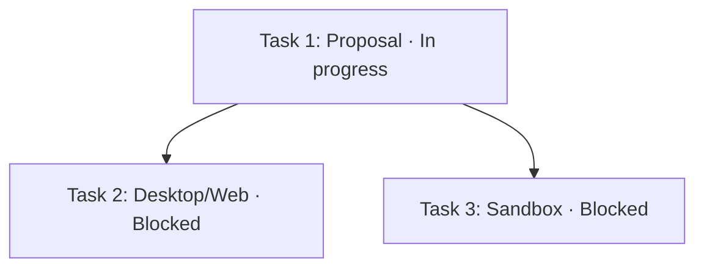

# Agent Team panel folding and task dependency graph design

English | [中文](team-panel-flow.zh.md)

Status: implemented (2026-10-05), pending on-device acceptance. Design date: 2026-10-04. The implementation described here lives in the working tree; multi-client on-device acceptance has not run yet.

## Summary

The right Team panel provides independently collapsible Members, Tasks, and Execution flow sections. Collapsed lists retain counts and status summaries. An execution flow graph shows active work and work waiting for prerequisites.

## Table of Contents

[Current data](#current) · [Layout and folding](#folding) · [Graph](#graph) · [State meanings](#states) · [Implementation scope](#scope) · [Acceptance](#acceptance)

## Current data and limitations

The current [TeamDashboard](../../../packages/experimental/client-ui-agent-team/src/client/TeamDashboard.tsx) groups members by activity and renders every task. [RosterGroups](../../../packages/experimental/client-ui-agent-team/src/client/Roster.tsx) headings do not collapse their groups. Task descriptions can expand, but this does not limit list length.

The [Team projection](../../../packages/experimental/agent-team/src/types.ts) supplies task IDs, titles, status, blockedBy, ready, ownerName, startedAt, and endedAt. It has no separate task failure, cancellation, or review approval state, and no task ownerId. The first graph uses existing fields and does not treat a name association as a stable member identity.

The graph only shows tasks recorded on the Team board. Natural-language plans and ordinary todos do not create nodes. The Lead should create all tasks before dispatch and reuse them through task_id; see the [feature list](../../../worktree-feature-list.md).

## Layout and folding

Sections appear in this order: Execution flow, Members, Tasks. Each heading provides a chevron button, name, count, and short status summary. Folding hides the body while headings and errors remain visible. All sections initially expand. Empty sections retain a brief empty state without taking focus.

Members use a compact card grid. Cards within each group sit alongside one another and wrap as available width changes. Narrow sidebars fall back to one column without fixed column counts or horizontal scrolling. Cards show name, status, and engine; longer descriptions appear in details. Truncated names remain fully accessible. Clicking a card still opens the member Session. Members always appear below the graph and above Tasks.

Member lists retain current activity groups, each independently collapsible. Tasks group into In progress, Pending, and Completed; blocked tasks belong to Pending. In progress and Pending initially expand, while Completed initially folds. Long lists use bounded scroll areas with existing layout tokens or a configurable presentation option to prevent unlimited sidebar growth.

Example folded headings are “Members 8 · Running 2” and “Tasks 12 · In progress 2 · Blocked 4 · Completed 6”. Counts include all current items regardless of folding and exclude deleted tasks. Expand all and Collapse all act on groups within the current section.

Folding preferences use the Team root Session ID, section, and group as keys in existing client preference facilities. If none fit, the first version keeps client state without Session log writes. Sibling member navigation preserves the Team preference; a different Team gets its own defaults. Updates preserve user choices, and new groups use default rules.

Heading buttons support keyboard control, aria-expanded, and aria-controls. Folding a body containing focus returns focus to its heading. Hidden content leaves Tab navigation. Copy uses typed locale dictionaries; colors, spacing, and icons reuse client components and theme tokens.

## Task dependencies and execution flow graph

Each nondeleted task produces one node. Every blockedBy prerequisite produces an arrow from that prerequisite to the task. Edges express execution constraints, not inferred dependencies from IDs, list order, or timestamps. Independent tasks appear alongside one another, including isolated tasks.

In the example, Tasks 2 and 3 depend on Task 1. Completing Task 1 makes both ready for dispatch; the Lead still decides when to start them. Requested human review requires confirmation first.

Nodes show title, status, ID, and owner. Truncated titles remain available in accessible names and details. Start and end times appear in task details to keep nodes compact. The narrow sidebar uses stable top-to-bottom dependency layers, with creation order within a layer; status changes do not reorder nodes.

Clicking or keyboard-selecting a node expands its task section and group, scrolls to the card, and highlights it. Details may open a reliably resolved member Session; unowned tasks show details only. Folding lists does not remove nodes. Viewing does not dispatch, claim, or complete work.

The graph provides Fit, Zoom in, Zoom out, and Fullscreen actions. Users pan within the graph container without automatically intercepting sidebar scrolling. Fit runs initially or on request; updates preserve the viewport. Completed tasks remain in the full graph so execution chains stay visible.

Edges distinguish completed and incomplete prerequisites through line styles and textual descriptions. Task states use icons and text as well as color. A brief legend explains the graph. Selecting a node exposes immediate prerequisites and dependents; the list remains an accessible equivalent.

## State meanings and updates

| Data | Display |
|---|---|
| pending, ready=false | Blocked; show incomplete prerequisites |
| pending, ready=true | Ready for dispatch; does not mean human approval |
| in_progress | In progress; show known inactive owner activity separately without inventing failure or completion |
| completed | Completed; satisfies prerequisites |
| deleted | Omitted from normal presentation |

Member provisioning failures, running activity, and idle activity remain separate from task status. The first version has no Review pending or Failed task state. Human review is explained as Lead coordination without parsing conversation prose. Structured approval requires separate persistence, authorization, and migration design.

The graph and lists use the same Team root projection, updating on completion, reopening, dependency edits, and deletion. Folded headings update counts. Only topology changes trigger layout; state and owner changes update content. Projection failure retains the last valid view with an error. Initial loading is distinct from an empty board.

The backend validates dependencies, but the client handles missing prerequisites, cycles, or layout failure with an explicit error and readable list. It neither discards tasks nor assumes completion. Missing prerequisites may use readonly placeholder nodes without Session navigation.

## Implementation scope and component ownership

Implementation belongs to client-ui-agent-team. Shared folding sections serve Dashboard and the header popover. Full graph interaction belongs to the right Dashboard; the popover retains folded lists and Open Dashboard rather than a large canvas. Reuse Team root subscriptions without subscribing to all member histories.

Proposed components are TeamSection, TaskGroups, TaskDependencyGraph, and a pure view conversion function; names are suggestions. Reuse task cards, member cards, state icons, navigation, and error notices. Inspected package manifests declare no graph layout dependency. Check repository facilities before choosing a maintained DAG layout library with SVG; avoid building a complex layout engine. Mermaid here illustrates the design and does not prescribe the product renderer.

Deliver folding first, then the readonly graph and node-to-task navigation, followed by Web, Desktop, narrow-sidebar, and large-graph validation. Scope excludes drag editing, automatic scheduling, automatic review, and new backend task states.

## Acceptance and feature status

Prepare branching, linear, independent, joining, reopened, and invalid projection scenarios. Verify folded counts, preferences surviving updates, locating hidden cards from graph nodes, completed prerequisites making tasks ready without starting them, and failed members not implying failed tasks.

Acceptance covers member cards wrapping with sidebar width, long names, single-column fallback, the graph always appearing first, keyboard focus, screen-reader list equivalents, both locales, themes, Web/Desktop, narrow windows, and bounded canvases with large task sets. Exercise configured task limits and measure layout cost and update stability. Add client behavior tests and recorded output snapshots during implementation.

The feature list records Design complete, implementation pending. Update the same entry after implementation and acceptance. Existing Sessions need no migration, and folding preferences do not enter model prompts.

## Dev Note

The implementation lives in packages/experimental/client-ui-agent-team: collapsible sections (TeamSection), task groups (TaskGroups), the read-only dependency graph (TaskDependencyGraph), and pure transforms (task-flow, fold-state, collapse-preferences). Layering uses an owned algorithm; no graph-layout dependency was added. Fold choices persist in the browser-storage key dsh.agent-team-panel.v1. Task descriptions clamp to one line behind an expand toggle, and an owner name resolved uniquely against the roster (names are Team-unique and immutable) opens the owning member's Session to inspect execution output; unclaimed or unresolved owners stay plain text. Behavior coverage lives in the package tests; narrow-sidebar, large-graph, and on-device multi-client acceptance are still outstanding.
