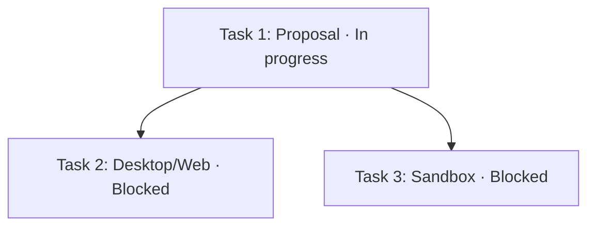

# Agent Team 面板折叠与任务流程图设计

[English](team-panel-flow.md) | 中文

状态：已实现（2026-10-05），待真机验收。设计日期：2026-10-04。本文描述对应实现已合入工作区，真机多端验收尚未执行。

## 概述

右侧 Team 面板提供独立可折叠的成员、任务与执行流程三个区域。用户收起长列表后仍能看到数量和状态摘要，并通过流程执行图理解哪些工作正在进行、哪些等待前置任务。

## 目录

[现有数据](#current) · [布局与折叠](#folding) · [流程图](#graph) · [状态含义](#states) · [实现范围](#scope) · [验收](#acceptance)

## 现有数据与限制

当前 [TeamDashboard](../../../packages/experimental/client-ui-agent-team/src/client/TeamDashboard.tsx) 按成员活动状态分组并逐项展示全部任务；[RosterGroups](../../../packages/experimental/client-ui-agent-team/src/client/Roster.tsx) 的分组标题没有折叠操作。任务卡可展开描述，但这不能控制整个列表长度。

[Team 投影](../../../packages/experimental/agent-team/src/types.ts) 已提供任务 ID、标题、状态、blockedBy、ready、ownerName、startedAt 和 endedAt。它不提供独立的任务失败、取消、审核通过状态，也没有可靠的任务 ownerId；第一版流程图只使用现有投影，不把名称关联当成稳定成员身份。

流程图只展示已写入 Team 任务板的任务。自然语言计划和普通 TODO 不会自动成为节点；Lead 应提前创建全部任务，并使用 task_id 派发已有任务，见[功能清单](../../../worktree-feature-list.md)。

## 布局与折叠

右侧面板由上至下为执行流程、成员、任务。三个标题均使用箭头按钮、区域名称、总数和简短状态摘要；折叠只隐藏正文，标题及错误提示始终可见。流程图默认展开，成员和任务默认展开；空区域保留简短空状态，不自动抢占焦点。

成员区域采用紧凑卡片网格，同组成员优先并列排布，随可用宽度自动换行；窄侧栏自然退为单列，不依赖固定列数或横向滚动。卡片显示姓名、状态和引擎，较长描述放在详情中；长姓名可截断，但完整文字须可访问。卡片点击仍打开成员会话。成员区域固定在流程图下方、任务区域上方。

成员列表保留现有状态分组，每组可独立折叠；任务列表按执行中、待执行、已完成分组，每组可独立折叠，等待依赖归入待执行。执行中和待执行默认展开，已完成默认折叠。列表较长时使用有界滚动区域，最大高度沿用现有布局 token 或新增可配置展示项，避免无限撑长侧栏。

收起的标题示例为“成员 8 · 运行中 2”“任务 12 · 执行中 2 · 等待依赖 4 · 已完成 6”。计数来自全部当前任务和成员，不受折叠影响；完成数量不包含已删除任务。提供“全部展开／全部折叠”，作用于当前区域的分组。

折叠偏好以 Team 根会话 ID、区域和分组为键，使用现有客户端偏好设施；若无合适设施，第一版保留在客户端状态中，不写入 Session 日志。打开兄弟成员会话沿用同一 Team 偏好，切换不同 Team 使用各自默认值；实时更新不覆盖用户选择，新出现的分组按默认规则展示。

标题按钮支持键盘操作、aria-expanded 和 aria-controls；折叠包含当前焦点的正文时将焦点移回标题。隐藏内容不继续参加 Tab 导航。中英文文案归 typed locale 字典，颜色、间距和图标复用现有客户端组件及主题 token。

## 任务依赖与执行流程图

每个未删除任务对应一个节点，blockedBy 中的每个前置任务对应一条从前置任务指向当前任务的箭头。图表达执行约束，不根据任务编号、列表顺序或开始时间编造依赖。没有依赖的任务并列展示；孤立任务也保留。

下图示例中，任务 2 和任务 3 都等待任务 1；首项完成后两项变为待派发，是否实际启动仍由 Lead 决定。用户要求人工审核时，Lead 必须先等待确认。

节点显示任务标题、状态、任务 ID 和负责人；标题截断时完整内容进入可访问名称和详情。开始／结束时间留在点击后的任务详情，避免节点过大。右侧窄栏默认从上到下排布，采用按依赖分层的稳定布局；同层按原始任务创建顺序，状态变化不重新排列节点。

点击或键盘选择节点后，展开任务区域及所在分组，滚动并高亮对应任务卡；详情允许进入已可靠解析的成员会话，未领取任务只展示详情。折叠列表不会删去图节点；仅展示模式不会派发、领取或完成任务。

图提供适应画布、放大、缩小和全屏查看操作。任务区域较大时，用户在独立图容器内平移；避免侧栏滚动被图默认拦截。默认适应仅发生在首次加载或用户点击时，实时更新保留视角。完整图仍包含已完成任务，不因完成导致执行链断裂。

每条边除箭头方向外，显示前置已完成或未完成的线型，并提供文字说明；任务状态使用图标和文字共同表达，不能只靠颜色。图旁提供简短图例；复杂图可通过节点选择查看其直接前置与后续任务，完整列表始终作为可访问的等价入口。

## 状态含义与更新

| 数据 | 展示 |
|---|---|
| pending，ready=false | 等待依赖；列出未完成的前置任务 |
| pending，ready=true | 待派发／可执行，不表示已获得人工审核 |
| in_progress | 执行中；负责人未运行时增加活动提示，不改成失败或完成 |
| completed | 已完成；以前置完成事实解除依赖 |
| deleted | 不展示，正常流程不再包含该任务 |

成员创建失败、运行中、空闲等信息独立于任务状态。第一版没有“等待审核”“失败任务”节点状态；人工审核仅以说明告知用户由 Lead 等待确认，不从对话文字猜测。若后续加入结构化审批，应另行设计持久数据、权限及迁移。

图和列表订阅同一个 Team 根投影，任务完成、重开、改依赖、删除后更新；折叠区也更新标题计数。新增或删除节点及依赖变化才重新布局，单纯状态和负责人变化只更新节点内容。投影失败显示最后有效内容与明确错误；首次未加载显示加载状态，不能显示为零任务。

后端已校验依赖图，但客户端仍应处理缺失前置、循环或布局失败：显示数据异常提示和可读列表，不丢弃任务、不臆造完成；缺失前置可展示只读占位节点，不能进入会话。

## 实现范围与组件归属

实现归属为 client-ui-agent-team：共享可折叠区域复用于 Dashboard 与头部弹出面板；图的完整交互放在右侧 Dashboard，头部面板保留成员、任务折叠和打开 Dashboard 的入口，避免在小弹层里放大型画布。沿用 Team 根订阅，不再订阅全部成员历史。

提议拆为 TeamSection、TaskGroups、TaskDependencyGraph 和纯展示数据转换函数；名称仅作为实现建议。任务卡、成员卡、状态图标、导航、错误提示复用现有实现。当前未发现这些包声明图布局依赖；实现时先检查已有仓库能力，必要时选择维护中的 DAG 布局库配合 SVG，不自研复杂布局器。本文 Mermaid 仅用于设计示意，不要求产品使用 Mermaid。

第一阶段交付列表和分组折叠；第二阶段交付只读依赖图及节点到任务导航；第三阶段验证 Web、Desktop、窄侧栏和大任务图的操作表现。范围不包含修改任务关系的拖拽编辑、自动调度、自动审核或新增后端任务状态。

## 验收与功能状态

实现前准备三任务分叉、线性链、并行孤立任务、多前置汇合、完成后重开及异常投影场景。实现验证折叠后计数仍正确、用户偏好不被更新覆盖、选择节点可定位隐藏任务、前置完成后待派发但不会自动启动，以及失败成员不被当成失败任务。

验收还覆盖成员卡片随侧栏宽度并列换行、超长姓名、单列回退、流程图始终位于最上方，以及键盘与焦点、屏幕阅读器等价列表、中英文、明暗主题、Web/Desktop、窄窗口以及大任务集合的有界画布。覆盖所有配置允许的任务数量，记录布局耗时和更新稳定性；相关客户端行为测试及录制输出快照在实施时补齐。

功能清单标记为“设计完成，待实现”。实现与验收通过后更新同一条目，不将本方案当作已完成产品功能。现有用户会话无需迁移；客户端折叠偏好不进入模型提示。

## 开发备注

实现位于 packages/experimental/client-ui-agent-team：折叠区域（TeamSection）、任务分组（TaskGroups）、只读依赖图（TaskDependencyGraph）与纯转换（task-flow、fold-state、collapse-preferences）；布局自研分层算法，未引入图布局依赖。折叠偏好存于浏览器存储键 dsh.agent-team-panel.v1。任务说明默认单行截断、可展开全文；负责人名称按名册唯一解析（名字团队唯一且不可变）提供打开成员会话查看执行输出的入口，未领取或无法解析时保持纯文本。行为测试与键控快照要求中的客户端行为覆盖见该包 tests；窄侧栏、大任务集与真机多端验收仍待执行。
